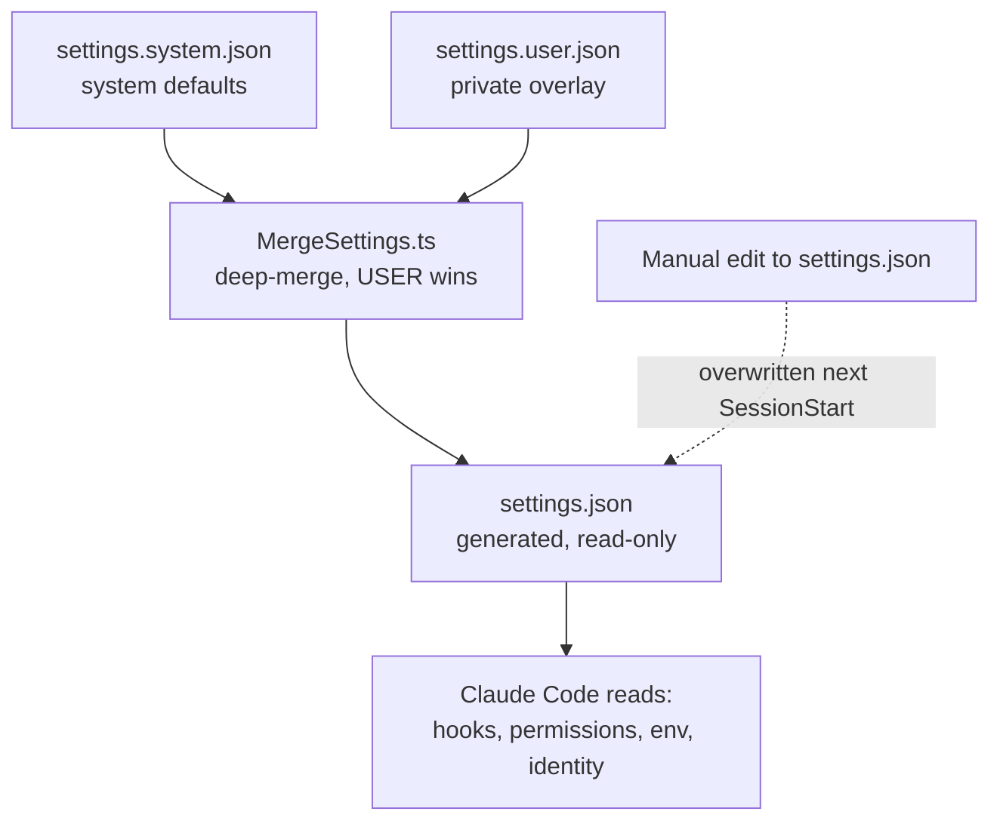

# WorkOS Configuration

> The system/user split is the WorkOS boundary made physical (`WorkOs/WorkOsThesis.md`): the OS (system tree) is the same for every install; the principal's *work context* (USER tree — identity, TELOS work goals, project state) is private to them. The merge machinery below is what lets one framework run for anyone without leaking their context.

WorkOS configuration follows the **system/user separation** contract (`WORKOS/DOCUMENTATION/SystemUserBoundary.md`). System config lives in the system tree; user config lives in the principal's private USER-data repo and mounts into the live tree via symlink. The two halves are merged at runtime — never at release time, never by hand.

## The split, end-to-end

```
~/.claude/                                       # SYSTEM tree
├── settings.json                                # Generated at SessionStart by MergeSettings.ts
├── settings.system.json                         # SYSTEM defaults
├── CLAUDE.md                                    # SYSTEM routing table
├── WORKOS/WORKOS_SYSTEM_PROMPT.md                     # SYSTEM constitutional rules
├── WORKOS/TOOLS/WorkosConfig.ts                       # SYSTEM typed loader (INTERFACE)
├── WORKOS/TOOLS/MergeSettings.ts                   # SYSTEM merge driver (INTERFACE)
└── WORKOS/USER → ~/.config/WORKOS/USER                # Symlink to USER tree

~/.config/WORKOS/USER/                              # USER tree (private USER-data repo, symlinked)
├── CONFIG/
│   ├── settings.user.json                       # USER settings overlay
│   ├── OPERATIONAL_RULES.md                     # USER operational rules (@-imported)
│   └── WORKOS_CONFIG.toml                          # USER typed-config implementation
├── PRINCIPAL/PRINCIPAL_IDENTITY.md              # USER identity (@-imported)
├── DIGITAL_ASSISTANT/DA_IDENTITY.md             # USER DA identity (@-imported)
├── TELOS/                                       # USER work goals + auto-generated PRINCIPAL_TELOS.md
├── PROJECTS.md                                  # USER project registry (@-imported)
└── INTEGRATIONS/*.yaml                          # USER per-integration configs
```

## Core files

| File | Tree | Purpose |
|------|------|---------|
| `settings.json` | SYSTEM (generated) | Merged at SessionStart by `MergeSettings.ts` from `settings.system.json` + `settings.user.json`. Read-only at runtime — manual edits get overwritten next session. |
| `settings.system.json` | SYSTEM | Defaults: permissions, env, notifications, tips (identity lives in `WORKOS_CONFIG.toml`, not here). (The shipped `install/settings.system.json` omits the `hooks` block — hooks ride separately in `install/hooks/hooks.json`, applied by InstallHooks at setup.) |
| `WORKOS/USER/CONFIG/settings.user.json` | USER | Per-principal overlay: identity values, principal name + timezone, custom `spinnerVerbs` + `spinnerTipsOverride`, env overrides. Deep-merged into system defaults; USER always wins. |
| `CLAUDE.md` | SYSTEM (with USER `@`-imports) | Routing table + top-level `@`-imports of USER identity files. Installed from `install/CLAUDE.template.md`. |
| `WORKOS/WORKOS_SYSTEM_PROMPT.md` | SYSTEM | Constitutional rules (system prompt layer, loaded via `--append-system-prompt-file`). |
| `WORKOS/USER/CONFIG/OPERATIONAL_RULES.md` | USER | Per-principal operational rules: repo conventions, env paths, vendor-specific doctrine (credential probes, deploy semantics). `@`-imported directly from `CLAUDE.md` — CC does not follow transitive `@`-imports. |
| `WORKOS/USER/CONFIG/WORKOS_CONFIG.toml` | USER | Typed user config (identity name/pronunciation/timezone, integration credentials, paths). Read via `WorkosConfig.load()`. |
| `WORKOS/TOOLS/WorkosConfig.ts` | SYSTEM (INTERFACE) | Typed loader. Returns a strongly-typed object; the schema is the SYSTEM↔USER contract. |
| `WORKOS/TOOLS/MergeSettings.ts` | SYSTEM | Deep-merge driver that produces `settings.json` from `settings.system.json` + `settings.user.json` at SessionStart. |
| `WORKOS/USER/INTEGRATIONS/*.yaml` | USER | Per-integration credentials/endpoints for private `_*` skills. |
| `WORKOS/USER/WORK/config.yaml` | USER (optional) | Work System settings: capture switches, TASKLIST order, read-only Jira/GitLab integration (`Work/WorkSystem.md`). |

## How it works at runtime

1. **SessionStart** — `MergeSettings.ts` reads `settings.system.json` + `WORKOS/USER/CONFIG/settings.user.json`, deep-merges (USER wins on conflict), writes `settings.json`. This file is what Claude Code reads for hooks, permissions, env, identity.

   **Merge semantics for arrays (public issue #1575, @dactylmedia):** a plain array in the user overlay REPLACES the system array wholesale — it does not extend it. Additive intent requires the annotation form: `{"__merge": "append", "values": [...]}`. A user hand-porting deny rules or hooks with a plain array clobbers the system's list; a user expecting append gets replace. The annotation is consumed at merge time and never appears in the output.

   **Overlay location is load-bearing:** the user overlay is read ONLY from `WORKOS/USER/CONFIG/settings.user.json`. A `settings.user.json` placed at the config root is never read — MergeSettings warns loudly when it sees one there.

   **Permission-rule shape — file rules are `Edit(path)`, never `Write(path)`.** The harness resolves file permissions against `Edit(...)` alone, and `Edit` covers every file-editing tool. `Write(/etc/**)` next to `Edit(/etc/**)` guards nothing and the CLI complains about it at startup. Verified by live probe, not by counting: with only `Edit(~/.claude/projects/**/memory/**)` present and no Write twin, the Write tool was DENIED there; with no Write allow rule present, Write to `~/.claude/` was ALLOWED (commit `b68b1a5c4`). **This has been "fixed" the wrong way three times** — 2026-07-16, 07-25, 07-27 — every time from an audit that read a settings file, saw an `Edit` rule with no `Write` twin, and filed it as an unguarded path. A config-shape count is not a behavior probe. Two teeth now hold the line: `MergeSettings.prunePermissionRules` strips `Write(...)`/`MultiEdit(...)` path rules out of the generated `settings.json` from whichever source layer they land in, and `/ic` check 15 `permission-rule-shape` BLOCKS on any that remain in a source layer. Bare `Write` with no specifier is a tool-level rule and is honored — it is untouched.
2. **Identity** — DA and principal values live in `settings.json` under `daidentity` and `principal` keys (provenance: USER overlay). Hooks read these via `hooks/lib/identity.ts` (`getIdentity()`, `getPrincipal()`, `getDAName()`).
3. **Skills** — private `_*` skills that need credentials/integration data read `WORKOS_CONFIG.toml` via `WorkosConfig.load()` (e.g. a private work skill reads an internal service endpoint or token name).
4. **CLAUDE.md `@`-imports** — at session start, CC loads files referenced by top-level `@`-imports in `CLAUDE.md` (ARCHITECTURE_SUMMARY, PRINCIPAL_TELOS, PRINCIPAL_IDENTITY, DA_IDENTITY, PROJECTS, OPERATIONAL_RULES). CC does NOT follow transitive `@`-imports from inside imported files, so identity files must be listed in `CLAUDE.md` directly.

## Editing

- **Identity / principal name / per-machine integrations** → edit `WORKOS/USER/CONFIG/settings.user.json` (USER overlay) or `WORKOS_CONFIG.toml`. Takes effect next SessionStart.
- **Hooks / permissions / system defaults** → edit `settings.system.json`. Takes effect next SessionStart.
- **Routing / `@`-imports / subsystem pointers** → edit `CLAUDE.md`. Takes effect next session.
- **Constitutional rules** → edit `WORKOS/WORKOS_SYSTEM_PROMPT.md`. Takes effect next session.
- **NEVER edit `settings.json` directly** — it's generated. Edits get overwritten on next SessionStart.

## Write-time enforcement

`hooks/SystemFileGuard.hook.ts` (PreToolUse, Phase E) blocks USER content from landing in SYSTEM files at write time. Fail-safe-open on hook errors. Primary defense against drift; catches violations the moment they would land. Tests: 19/19 pass.

## Two-repo sync

The two trees are physically separate git repos, both on PRIVATE, employer-approved remotes:
- `~/.claude/` → the system repo
- `~/.config/WORKOS/USER/` → the principal's user-data repo

There is no pre-push auto-sync git hook and no public release pipeline in this fork. Before pushing either repo, confirm the remote is private and approved (`git remote -v`).

## Migration history

- **Phase B (2026-05-21)** — `settings.json` split into `settings.system.json` + `settings.user.json` (USER). `MergeSettings.ts` merges at SessionStart.
- **Phase C (2026-05-22)** — `CLAUDE.md` becomes thin router with direct `@`-imports of USER identity files. `OPERATIONAL_RULES.md` created in `WORKOS/USER/CONFIG/`. `CLAUDE.user.md` sidecar created and then deleted 2026-05-23 (merged back into `CLAUDE.md`) because CC doesn't follow transitive `@`-imports.
- **Phase E (2026-05-22)** — `SystemFileGuard.hook.ts` runtime write-time enforcement begins.
- **Phase F (2026-05-22)** — `WorkosConfig.ts` typed loader + `WORKOS_CONFIG.toml` populated. Private skills migrated from hardcoded credentials to `WorkosConfig.load()`.
- **Phase G (2026-05-22→23)** — separate private GitHub repo created for USER data. `~/.claude/WORKOS/USER` becomes symlink to `~/.config/WORKOS/USER`. Two-repo sync is handled by the UpdateKaiRepo workflow (no pre-push git hook — stale claim corrected 2026-07-04).
- **Phase H (deferred)** — PR-time `DenyListCheck` via GitHub Actions; community v5→v6 migration tool.

## Pre-v6.0 history

The pre-Phase-A model used `WORKOS_CONFIG.yaml` as a credentials store and a single `settings.json` directly edited by hand. There was no system/user boundary enforced at write time; defenses were release-time only. That model is retired — the contemporary architecture is the split + symlink + `WorkosConfig.ts` described above.

## Examples

### One framework, two different machines

The whole split at its smallest: **two engineers install the same WorkOS, and their running config comes out different.**

The system half is identical for both — same `settings.system.json`, same defaults. What differs is the USER overlay each keeps in their own private repo. At SessionStart, `MergeSettings.ts` deep-merges the two, and USER wins on any conflict:

- The shipped default sets a generic DA name and timezone.
- One engineer's `settings.user.json` names their own DA and timezone.
- After the merge, their `settings.json` carries *their* values; the other's carries the defaults.

Neither edited the system file. The framework stayed the same for everyone; the principal's context stayed private to each.

### Which file do I edit?

Because `settings.json` is generated, editing it is wasted work:

- **Change your DA name or timezone?** → the USER overlay (`settings.user.json`). It survives, and it wins the merge.
- **Change a system default or a hook?** → `settings.system.json`.
- **Change `settings.json` directly?** → don't. It's regenerated next SessionStart and your edit is gone.

The test is simple: is this *the framework* or *your context*? Framework goes in the system tree; your context goes in the USER overlay.

### The merge, at SessionStart



The diagram is the boundary made mechanical: two inputs, one deterministic merge, one generated output the runtime actually reads. The dashed edge is why hand-editing the output never sticks — the next session rebuilds it from the two sources.

---

## Cross-references

- System/user boundary contract: `WORKOS/DOCUMENTATION/SystemUserBoundary.md`
- Master architecture: `WORKOS/DOCUMENTATION/WorkosSystemArchitecture.md`
- Hook system: `WORKOS/DOCUMENTATION/Hooks/HookSystem.md` (SystemFileGuard, MergeSettings invocation)
