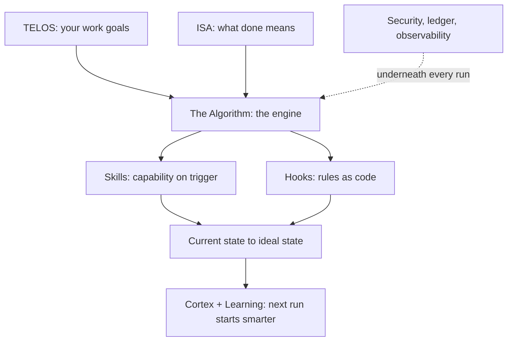

# WorkOS Core Components

WorkOS is the AI harness that moves your work from where it is now to where it should be — an intent engineering platform. Every task — fixing a bug, shipping a service, writing a design doc — is the same move, from **current state to ideal state**, pursued through verifiable iteration, with your intent conveyed into every run.

That one loop is built from a set of components — the **unique features** WorkOS adds. Anything a good harness already provides on its own (built-in subagents, for example) isn't listed here.

This doc is the canonical map. Each component links to its full reference.

---

## The Unique Features

The sixteen things that make WorkOS WorkOS.

### 1. Current State → Ideal State

The whole philosophy in one line: name where the work is, name where it should be, then close the gap with steps you can check. Ideal state is written down as testable criteria, so "done" can't drift — you either meet the criteria or you don't. Everything else in the system serves this move.

→ `WorkOs/WorkOsThesis.md`

### 2. Intent Engineering

The platform's defining job: capture what you want — TELOS for your work goals, ISAs per task — and convey that intent to your AI on every run, then verify the output against it. Direction, not execution, is AI's bottleneck; this component is the fix. And it's still prompting: the WHAT layer of it, productized.

→ `WorkOs/WorkOsThesis.md`

### 3. General Hill Climbing

The loop under everything. The ideal state is the top of the hill, broken into testable criteria that tell up from down. On every task the system picks the next move that reduces the gap, checks it against those criteria, and keeps what moves uphill. It's general because the same climb works for any kind of work — code, a migration, a design doc, a hard decision. No check means no gradient, so verification is what makes the climb real.

→ `WorkOs/WorkOsThesis.md`

### 4. Euphoric Surprise

The quality bar the whole climb aims at: the right output, in the right time, for the right spend — good enough that you didn't have to ask twice. It is the meta-ideal-state of every ISA: each ISA names the specific ideal state of one piece of work, and above every one sits this same universal goal.

→ `WorkOs/WorkOsThesis.md`

### 5. TELOS

Where you write down your work goals: professional mission, sprint / quarter / career goals, problems, strategies, and challenges. From then on every recommendation is framed against it, so the system works toward what actually matters in your role, not a generic answer.

→ `WorkOs/WorkOsThesis.md`

### 6. The Algorithm

The centerpiece. The unified thinking system that takes a vague request, turns it into a hard-to-vary spec (the ISA), and climbs toward it with verified iteration, closing each claim only on real evidence. It scales its own effort to the work — a fast lane for simple asks, full depth for hard ones — discovered from the task rather than a fixed set of phases.

→ `Algorithm/AlgorithmSystem.md`

### 7. ISA System

The Ideal State Artifact — one document that captures what "done" looks like as verifiable criteria. It works like a product spec, but general, for any task. It breaks the ideal state into discrete Ideal State Criteria (ISCs) that double as the test harness, so every Algorithm run reads, extends, and checks against one living document.

→ `ISA/ISASystem.md`

### 8. Cortex

The memory system — everything WorkOS knows. Hooks and an autonomic reviewer consolidate what each session taught, and the tiered store keeps it — hot-layer facts, a typed knowledge graph, learnings, and work history — so every session starts smarter than the last.

→ `Memory/MemorySystem.md`

### 9. Atlas

The current state of everything you own or operate. Repositories, servers, services, and credentials held as one graph rather than a list, so you can ask what you have, what depends on what, and what a single compromise would reach.

→ `Atlas/AtlasSystem.md`

### 10. Ledger

The change-tracking system. Every change gets the right version and leaves a queryable record — system edits classified and bumped (Major.Feature.Patch across the OS and every component), an append-only update registry, integrity-gated changes, drift nagging, and deploy events. One place answers "what changed, when, at what version, verified how."

→ `Ledger/LedgerSystem.md`

### 11. The Skill System

Self-activating, composable units of domain expertise. A skill is deterministic code wrapped in a natural-language trigger, so the right capability fires the moment you describe the task — no menu, no command to remember.

→ `Skills/SkillSystem.md`

### 12. The Hook System

Deterministic lifecycle interception. Hooks run at fixed points across a session — before a tool call, after output, at session start and stop — and enforce the rules a model can't be trusted to remember every time. The guardrails are code, not good intentions.

→ `Hooks/HookSystem.md`

### 13. Observability

Every tool call, agent, and failure appended to local JSONL logs, plus the work registry (`work.json`) that carries each run's state and claim progress. Readers pull what they need on demand; nothing leaves the machine.

→ `Observability/ObservabilitySystem.md`

### 14. Learning

Every run reflects on itself. What worked, what didn't, and what a smarter version would have done gets captured and fed back into how the system behaves next time.

→ `Memory/MemorySystem.md`

### 15. Security

Privacy and safety are enforced, not assumed. Deterministic gates keep employer code, customer data, and credentials where they belong, treat outside content as read-only, and block anything unsafe before it runs.

→ `Security/README.md`

### 16. Custom Spinner Verbs

While WorkOS works, the statusline shows a custom animated working-verb alongside rotating tips about the system.

→ `Spinner/SpinnerSystem.md`

---

## How they fit together

Current-state-to-ideal-state is the **why**, intent engineering is the **job**, and Euphoric Surprise is the **bar** it aims for. The Algorithm is the **engine** that runs it, and the ISA is the **spec** it climbs against. Skills and hooks are the **machinery** that make each run capable and safe. Cortex and Atlas are what it **knows** — what you've learned and what you operate — and Ledger is the **record** of every change. Observability and the spinner are how you **see** it. Learning is how every run **feeds** the next, and security is the **gate** under all of it.

---

## Examples

### One task, through the components

Take **fixing an intermittent duplicate-posting bug in a .NET settlement service.**

- **TELOS** frames it — a standing goal to bring the settlement pipeline's error rate down this quarter, so the fix is not judged in a vacuum.
- **The ISA** writes down what "done" means as checkable criteria: a test reproduces the race, the fix makes it pass repeatedly, no duplicate rows in a SELECT over the test run.
- **The Algorithm** runs the climb — reproduce, fix, check against the criteria — spending little on the easy parts and more on the concurrency reasoning.
- **A skill** fires when the task is described — e.g. the MR-description skill once the diff exists.
- **A hook** enforces what can't be left to memory — no done-claim without tool evidence.
- **Cortex** keeps what the run learned, so the next incident in that service starts smarter.

### Spend matches the task

- **"What's the default isolation level in SQL Server?"** touches almost nothing — answered in one step. No ISA, no skill, no agents.
- **"Migrate the service from .NET 6 to .NET 8"** lights up most of it — an ISA with many criteria, parallel agents, security gates, memory of every decision.

Same components, very different depth, because effort is read off the task, not fixed in advance.

### The components, working together

