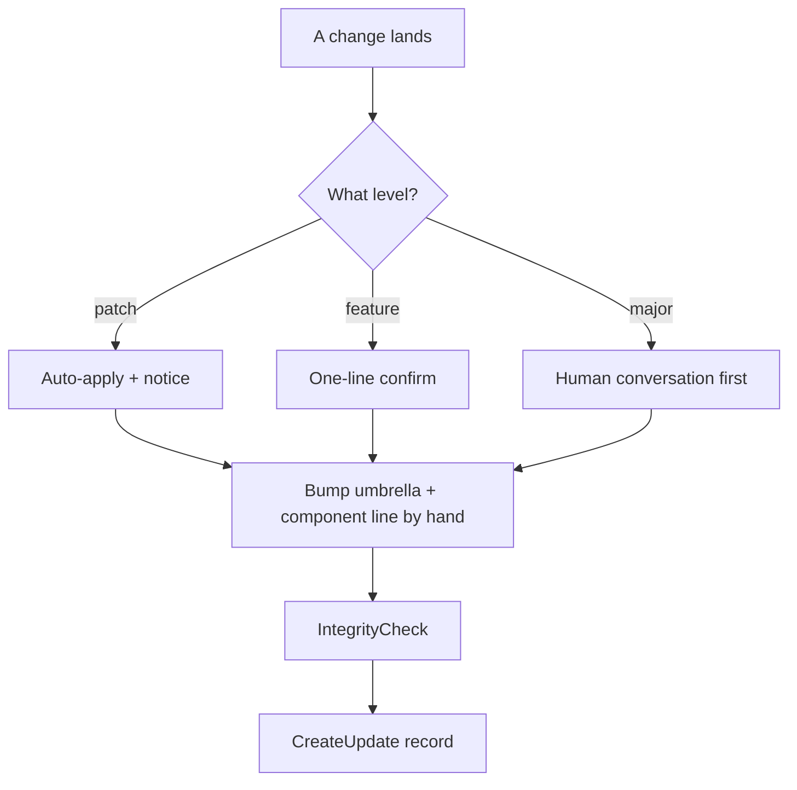

# Ledger — the WorkOS Change-Tracking System

> **Note:** the release and versioning tools (`ClassifyChange`, `UpdateWorkosVersion`, the `Bump*Versions` family, `UpdateIndex`, `UpdateKaiRepo`, `DocVersionScope`, `SeedDocVersions`, and the `/vb` and `/ud` workflows) are not part of this fork. Nothing here classifies a change, bumps a version, rebuilds a changelog index, or syncs and tags a repo. What ships is the version scheme, the update-file writer, the integrity check, the drift nag, and the deploy-event record. Version numbers are bumped by hand.

> **Ledger is the subsystem that knows what changed, when, at what version, verified how.** In this fork it is the version scheme, an update registry written by `CreateUpdate.ts`, an integrity check that stamps clean passes, a drift nag, and an append-only deploy record.

**History:** named Ledger 2026-07-06 (1.0.0), demoted to an unnamed convention 2026-07-12, revived 2026-07-19 at 2.0.0.

The one-line test for what belongs to Ledger: **does it decide, record, or propagate a version — or record and gate a change?** If yes, it's Ledger.

**Design boundary (constitutive, not aspirational):** Ledger is the *record and the read surface*, never an orchestration layer. It adds no daemon and no required gate on unrelated flows.

---

## The scheme — always three levels, Major.Feature.Patch

Every live version identifier in WorkOS is exactly three levels: **`Major.Feature.Patch`**. No two-level, no four. This binds the whole version surface — the OS version (`WORKOS/VERSION`), the Algorithm (`WORKOS/ALGORITHM/LATEST`), the system prompt, the ISA Format spec, Memory, every skill's `version:`, every hook's `@version`, every living doc's frontmatter `version:`, and any new component line. **This section is the standing rule's system home.** It does not live in `OPERATIONAL_RULES.md`: that is a per-principal USER file shipped as a stub, so a system-wide rule placed there would not survive into any install. A principal may restate it there for their own tree; the source of truth is here.

| Level | Meaning | Gate |
|-------|---------|------|
| **Major** | Breaking or structural change — a format-schema change, a removed contract, a restructured subsystem | Human conversation required before the bump |
| **Feature** | Additive capability — a new section, workflow, subsystem | One-line confirm at ship time |
| **Patch** | Fix, doc, or no-behavior-change edit | Auto-applies with a visible notice |

The middle number is **Feature**, not "minor." In this fork the level is chosen by judgment, not by a classifier tool.

**Scope:** the rule governs every *live* marker and all *new* bumps. Dated changelog entries recording a past state stay as recorded — back-filling history is revisionism, not versioning.

---

## Umbrella + component model

Two granularities of the same fact:

- **The OS umbrella** — `WORKOS/VERSION`. The single rolled-up number for the whole system; every substantive change rolls into it.
- **Component lines** — independently versioned subsystems that move at their own pace and roll up: the **Algorithm** (`LATEST` → `v{X.Y.Z}.md` + hand-authored `changelog.md`), the **system prompt** (frontmatter `version:`), the **ISA Format** spec, **Memory**, each **skill** (`version:`), each **hook** (`@version`), and every living doc (frontmatter `version:`).

A single skill edit bumps both the skill's line and the umbrella: component and umbrella are different granularities of one fact. Here both are edited by hand.

**Estate extension (2.0.0):** deployed projects (services, apps) join the version surface through the per-project convention below — each carries its own `VERSION` (or `package.json` version), recorded at every deploy.

---

## The components (the tools that ship)

| Tool | Role |
|------|------|
| `WORKOS/TOOLS/CreateUpdate.ts` | **Record.** Writes one typed update file per system change to the registry and prepends it to `INDEX.md` (4–8-word real title enforced). |
| `WORKOS/TOOLS/IntegrityCheck.ts` | **Integrity gate.** The deterministic backbone behind `/ic`: one pass across references, version anchors, hook registration and wiring, skills, workflows, CLAUDE.md imports and more. Every run stamps `MEMORY/STATE/integrity/last-run.json`; a fully clean run also stamps `last-pass.json`. |
| `hooks/IntegrityCheck.hook.ts` | **Integrity tooth.** SessionEnd hook that detects system file changes and spawns background maintenance. |
| `WORKOS/TOOLS/LedgerDeployEvent.ts` | **Estate record.** Appends a deploy event (project, target, domain, git SHA, project version, ok/fail) to `deploys.jsonl`; `list` reads it back. |
| `hooks/VersionDrift.hook.ts` | **Drift tooth.** UserPromptSubmit nag (`VERSION-DRIFT`) at ≥10 changed core files since the last `v*` tag, or any drift on a tag older than 48h. Silent once `WORKOS/VERSION` has moved past the tag. |

---

## The records (what Ledger writes)

Under `WORKOS/MEMORY/SYSTEMUPDATES/` (created at runtime in the user's tree; not shipped):

- **`YYYY/MM/*.md`** — one file per system change, typed (`significance`, `change_type`, `purpose`, `expected_improvement`, `files_affected`), written by `CreateUpdate.ts`.
- **`INDEX.md`** — newest-first list, prepended to by `CreateUpdate.ts`.
- **`deploys.jsonl`** — append-only estate deploy events (2.0.0), written by `LedgerDeployEvent.ts`.

Component-local records stay component-local by design: the Algorithm's `changelog.md` (doctrine history + migration/rollback recipes) and each project's own git history are feeds, not duplicates.

---

## The flow

```
system change lands
  → decide the level by hand           # patch | feature | major (major: talk first)
  → bump WORKOS/VERSION and the touched component lines by hand
  → bun WORKOS/TOOLS/IntegrityCheck.ts # feature/major: run before calling it done
  → bun WORKOS/TOOLS/CreateUpdate.ts   # record the change

estate deploy lands (any service/app via the gated deploy path)
  → LedgerDeployEvent.ts record        # project, target, domain, SHA, version, ok
```

`VersionDrift.hook.ts` nags when core drift accumulates unbumped, so the reminder is wired into the harness rather than left to memory.

---

## Per-project versioning (the estate convention, 2.0.0)

Every deployed project (service, app) SHOULD carry a version: a repo-root `VERSION` file (one line, `Major.Feature.Patch`) or a `package.json` `version`. `LedgerDeployEvent.ts` resolves it in that order at deploy time and records it with the git SHA.

- **Absence never blocks.** The SHA is always recorded; `version: null` is a nudge, not a gate. Seeding is incremental — add `VERSION` the next time each project ships.
- Bump levels follow the same Major.Feature.Patch semantics; the project owner picks the level at ship time.
- Project ISAs remain the state-of-record for *what the project is*; Ledger records *what shipped when*.

---

## What Ledger is NOT

- **Not a release/publish system.** This fork has no release, tagging, or sync tooling.
- **Not an orchestrator or scheduler.** No daemon, no new required gates on unrelated flows.
- **Not a monitoring system.** Status output is a *feed* a reader can join against, not part of Ledger.

---

## Examples

### One change through the Ledger

A developer adds a new workflow to an existing skill.

1. **Choose the level.** New capability, nothing broken: **feature**. (A doc typo is `patch`; a removed contract is `major` and needs a human conversation before any number moves.)
2. **Bump two numbers by hand.** The skill's own `version:` line and the OS umbrella in `WORKOS/VERSION`. They are the same fact at two zoom levels, the subsystem and the whole system.
3. **Check integrity.** `IntegrityCheck.ts` runs a full pass; a clean run writes the `last-pass.json` stamp.
4. **Record.** `CreateUpdate.ts` writes one registry file with a real four-to-eight-word title.

If step 2 is forgotten, `VersionDrift.hook.ts` nags on the next prompt once core files pile up unversioned since the last tag.



---

## Cross-references

- Standing rule — this doc, § The scheme (a principal's `WORKOS/USER/CONFIG/OPERATIONAL_RULES.md` may restate it, but that file ships as a stub and is not the source)
- Master architecture — `WORKOS/DOCUMENTATION/WorkosSystemArchitecture.md` § Ledger
- Algorithm component changelog — `WORKOS/ALGORITHM/changelog.md`
