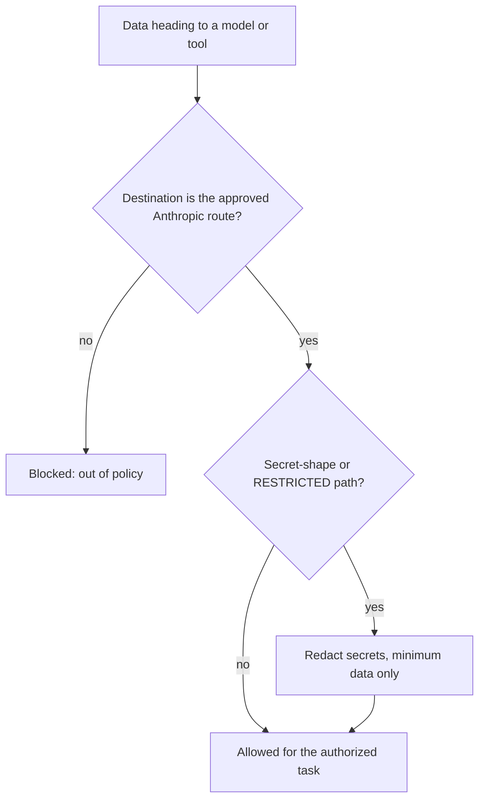

# WorkOS Data Classification & Inference-Source Routing

> The doctrine that decides **which inference source may process which data**. Four data classes, one inference vendor, fail-closed.

## Why this exists

Every model call is a data-egress surface. In this work fork there is exactly **one inference vendor: Anthropic** (Claude models, reached through the employer-approved provider, e.g. Bedrock). No other model vendor or broker is wired — no OpenAI/Codex, Gemini, Grok, Perplexity, OpenRouter, or on-device route. This doctrine classifies every piece of data so it is handled correctly even inside that one route: what may go into prompts, memory, logs, and artifacts, and what must be redacted.

**The core principle: content is ranked by sensitivity, and the system only sends data to the approved Anthropic route — never to any other external service for inference. Unclassified data is RESTRICTED (fail-closed).**

## The four data classes

| Class | Rank | One-line test | Leak consequence |
|-------|------|---------------|------------------|
| **RESTRICTED** | 0 (highest) | "If this showed up in someone else's logs, do I have to rotate something or notify someone?" | Irreversible — rotation, breach notice, contract/law break |
| **CONFIDENTIAL** | 1 | "Is this employer-internal: unreleased code, architecture, security posture, roadmap, or my own work context?" | Real harm (competitive loss, security exposure) — no rotation |
| **INTERNAL** | 2 | "Would I shrug if a trusted colleague saw this, but it isn't published?" | Low — reveals how the system works, not sensitive specifics |
| **PUBLIC** | 3 (lowest) | "Is this already on the internet, or built to go there?" | None — already public |

**RESTRICTED** — auth material, customer data, PII. `.env` + anything quoting it; API keys, tokens, connection strings, signing keys; customer- or tenant-owned data (accounts, balances, transactions, wallet addresses tied to a person); colleagues' or customers' PII; production data extracts. Paths: `**/.env`, `WORKOS/USER/CONFIG/CREDENTIALS/**`, `WORKOS/USER/WORK/CUSTOMERS/**`, `WORKOS/USER/CONTACTS.md`. **Also the fail-closed default.**

**CONFIDENTIAL** — employer-internal and principal work context: employer source code and architecture, internal infrastructure and hostnames, security findings, incident details, TELOS work goals, hot-layer + relationship memory, People/Companies notes. **Default for all of `WORKOS/USER/**`** except RESTRICTED sub-globs and named PUBLIC demotes.

**INTERNAL** — private but not sensitive: ISAs without customer data, work notes, plans, non-secret config, WorkOS system internals. Paths: `WORKOS/MEMORY/**`, `skills/**`, `WORKOS/USER/CONFIG/**` (minus CREDENTIALS), `CLAUDE.md`, `WORKOS/WORKOS_SYSTEM_PROMPT.md`.

**PUBLIC** — already published: public documentation, open-source library docs, public package metadata.

## The inference source

| Tier | Source | Vendor | Egress |
|------|--------|--------|--------|
| 1 | **NATIVE** | Anthropic (via the employer-approved provider) | the one approved vendor |

Every class may reach the NATIVE route **for an authorized task**, subject to the Restricted Data rules in the system prompt: minimum data necessary, credentials always `[REDACTED]`, nothing retained beyond the task. Any other inference destination is out of policy, whatever the class.

## Marking convention

Path-default-first, fail-closed, mark-only-the-exceptions:

1. **Path defaults** via `WORKOS/USER/CONFIG/data-classification.json` (longest-match wins). *"If you didn't tag it, it's as locked as its directory."*
2. **Demote-only tags** — public-facing files inside a stricter tree carry `data_class: PUBLIC` frontmatter. Tag *down* only.
3. **Auto-promote by content** — a secret-shape match anywhere → RESTRICTED.
4. **In-flight requests** declare class; inline `[[dc:public]]` for one-offs.
5. **Precedence**: auto-promote > explicit tag > path default; conflicts resolve to the more restrictive.
6. **Mixed payloads inherit the highest class** of any constituent.

## Enforcement

- **Single vendor by construction** — no non-Anthropic inference tool or agent ships in this fork, so there is no second route to gate.
- `hooks/EgressClassGuard.hook.ts` + `hooks/lib/egress-class-core.ts` — the upstream PreToolUse Bash gate that blocked over-ceiling payloads to the (now removed) broker route. It logs to `WORKOS/MEMORY/OBSERVABILITY/egress-decisions.jsonl`.
- `WORKOS/USER/CONFIG/data-classification.json` — path-default glob table.
- The sandbox's deny-all egress policy is the outer wall: anything not explicitly allowed cannot leave.

**Known limits (honest):** classification here governs what the system *chooses* to send and store; it does not inspect file contents a tool reads at runtime, nor free-prose PII with no token shape or path reference.

## Gaps / roadmap

1. **`data-classification.json` needs review** for the employer's own data categories.
2. **Secret-shape scan catches tokens, not prose PII.**
3. **Return-path leakage** — the doctrine governs input, not what a response echoes into logs or artifacts; the Restricted Data rules cover that by instruction.
4. **Non-inference egress** (WebFetch/WebSearch, skill HTTP calls, Apify/BrightData scraping) is governed by the sandbox egress allowlist, not by this doc. Never send CONFIDENTIAL or RESTRICTED data to them.

## Examples

### One request, two files, two handlings

A workflow summarizes two files for an MR description:

- **A design note** under the memory tree, no secrets — INTERNAL. It goes into the prompt as-is.
- **A deploy script that names a credential** — the scan sees a token-shaped string, so the class becomes RESTRICTED. The script's logic may be summarized, but the token value is `[REDACTED]` in the prompt, the summary, and the MR text.

Same route, opposite handling — decided by the *content*.

### Where data may go

- **The Anthropic route** — any class, for an authorized task, minimized and redacted.
- **Any other model or AI service** — never. Not configured, not allowed.
- **Scrapers and web tools (Apify, BrightData, WebFetch)** — PUBLIC queries only; never paste employer code, customer data, or credentials into them.
- **Unclassified anything** — treated as RESTRICTED.

### The decision as a picture

---

