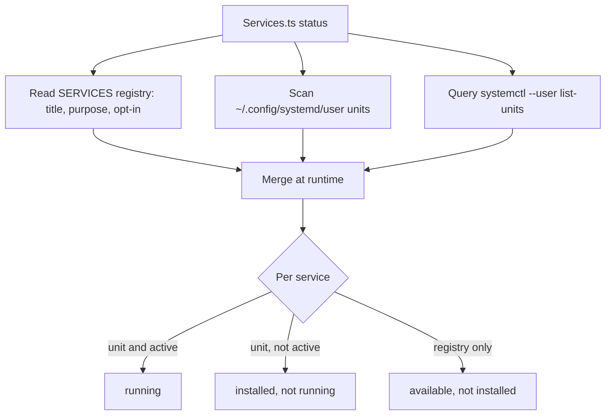

# WorkOS Background Services

> **Every recurring service WorkOS can run, in one place — what it is, how often it fires, and how to install it. One tool controls them all: `WORKOS/TOOLS/Services.ts`.** Services are `systemd --user` units (Linux only). Every one is opt-in; a host without a user systemd session (e.g. a sandbox microVM) simply runs none of them, and the tools stay runnable on demand.

## The one-shot

```bash
bun ~/.claude/WORKOS/TOOLS/Services.ts status              # what's running vs installed vs available
bun ~/.claude/WORKOS/TOOLS/Services.ts install --all --yes # stand up every service
bun ~/.claude/WORKOS/TOOLS/Services.ts install --only worksweep,atlas --yes
bun ~/.claude/WORKOS/TOOLS/Services.ts uninstall --only atlas
bun ~/.claude/WORKOS/TOOLS/Services.ts doc                 # regenerate the table below
```

`status` and `doc` are **read-only** (safe anytime). `install`/`uninstall` call `systemctl --user` — a privileged step, so the human (or the installing AI, with permission) runs them; `install` without `--yes` is a dry preview.

## How it works

`Services.ts` is a single registry (`SERVICES`) of human-meaningful metadata — title, purpose, category, opt-in, install command — merged at runtime with the **actual units on disk** (`~/.config/systemd/user/com.workos.*.{service,timer,path}`). Cadence and run-state are read live from the unit files and `systemctl --user list-units`, so `status` reports reality, never a stale hand-maintained guess. Adding a service = one row in `SERVICES` pointing at its existing `Install*.ts`; the tool orchestrates, it does not re-implement each installer.

Two jobs that used to be scheduled elsewhere — the nightly memory consolidation (`SessionHarvester.ts --recent 20 && LearningPatternSynthesis.ts --week`) and `ProposalGC.ts --auto` — are not services: the `MaintenanceJobs` SessionStart hook runs them when they are due, so they need no scheduler.

## Categories

- **sync** — keep derived artifacts current (derived-file sync, Atlas).
- **sweep** — periodic scans that create work items (work sweep, commitments).
- **maintenance** — housekeeping (Knowledge Archive distill).

## The services (generated from the live units)

<!-- generated by `bun WORKOS/TOOLS/Services.ts doc` — do not hand-edit; update SERVICES in Services.ts -->

| Service | Category | Cadence | Opt-in | Purpose | Install |
|---------|----------|---------|--------|---------|---------|
| **Cortex distill (weekly digest)** `com.workos.distill` | maintenance | — | yes | Weekly harvest of the Knowledge Archive into a routed digest — upgrades, archive health. | scheduled by the Cortex skill's distill workflow — bun ~/.claude/WORKOS/TOOLS/KnowledgeDistill.ts run --headless |
| **Work sweep** `com.workos.worksweep` | sweep | — | yes | Hourly work capture into the local ledger — untracked sessions, stale items, project checks, TELOS work-goal derivation. Also run hourly by `hooks/MaintenanceJobs.hook.ts` without systemd, so this timer is an optional extra. | `bun ~/.claude/WORKOS/TOOLS/InstallWorkSweep.ts` |
| **Atlas asset-graph sync** `com.workos.atlas` | sync | — | yes | Reconciles the Atlas asset graph — 15-min tick (hourly full sync) + event-hint targeted syncs. | `bun ~/.claude/WORKOS/ATLAS/InstallAtlas.ts` |
| **Derived-file sync** `com.workos.derivedsync` | sync | — | yes | Watches USER source files; regenerates PRINCIPAL_TELOS and the deny-hash corpus on hand-edits. | `bun ~/.claude/WORKOS/TOOLS/InstallDerivedSync.ts` |
| **Commitment sweep** `com.workos.commitmentsweep` | sweep | — | yes | Daily 07:00 digest of open `commitment` ledger items (overdue / due today / this week). Also run every 20 h by `hooks/MaintenanceJobs.hook.ts`, so this timer is an optional extra. | `bun ~/.claude/WORKOS/TOOLS/InstallCommitmentSweep.ts` |

Cadence shows `—` until a unit is installed on the host the table was generated on.

## Fresh install

The WorkOS install skill (`skills/WorkOS/`, `DeployComponents.ts`) offers the background services as opt-in components (`worksweep`, `derivedsync`, `commitmentsweep`) and delegates each to `Services.ts`. `Services.ts install --all --yes` is the complete-coverage path on a Linux host with a user systemd session. Without one, decline the services and run the tools on demand.

## Examples

### One command, the whole fleet

An operator wants to know what is actually running. `Services.ts status` merges the registry with the units on disk and `systemctl --user` run-state, then prints reality in three buckets:

- **running** — installed and firing on its cadence (e.g. the Atlas timer).
- **installed, not running** — a unit exists but is not active.
- **available, not installed** — a service WorkOS knows about but this host has not stood up yet.

One command stands up a missing one:

```bash
bun ~/.claude/WORKOS/TOOLS/Services.ts install --only worksweep --yes
```

### How status stays honest



---

## Cross-references

- Control tool: `WORKOS/TOOLS/Services.ts`
- Install skill: `skills/WorkOS/` (`skills/WorkOS/Tools/DeployComponents.ts`, `skills/WorkOS/INSTALL.md`, `skills/WorkOS/Workflows/Setup.md`)
- Work system: `WORKOS/DOCUMENTATION/Work/WorkSystem.md`
