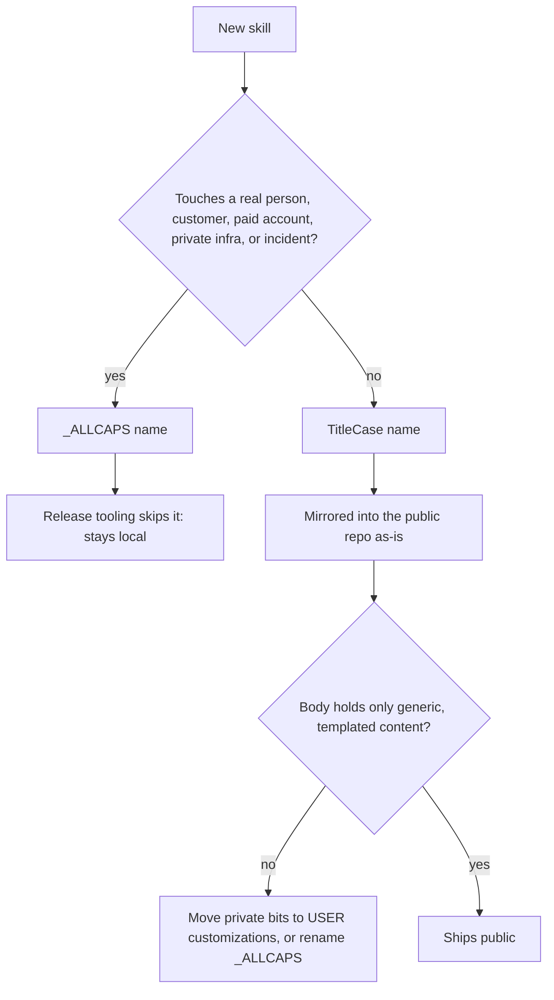

# Custom Skill System

> Skills are WorkOS's action surface. The thesis (`WORKOS/DOCUMENTATION/WorkOs/WorkOsThesis.md`) puts it directly: "Skills expand so the DA can take more actions to close the gap." Every skill added is a new class of move the DA can make in the current→ideal-state hill-climb; the structure rules below exist so those moves stay discoverable, composable, and safe to ship.

**This document is the authoritative definition of the required structure for every WorkOS skill; all skill creation — including CreateSkill's — conforms to it. "Canonicalize a skill" = restructure to match this exact format, including TitleCase naming. A skill that doesn't follow it is not properly configured and will not work correctly.**

---

## Naming Convention — Public vs Private (MANDATORY)

**A skill's name encodes its public/private status. There are exactly two valid forms; the canonical statement of the rule lives in `skills/CreateSkill/SKILL.md` § "Naming Convention — Public vs Private".**

| Skill type | Directory format | Example | Allowed content |
|------------|------------------|---------|-----------------|
| **Public** | `TitleCase` | `MergeRequestDescription`, `QaTestNotes`, `CreateSkill` | Templated, safe, generic, ready for public release |
| **Private** | `_ALLCAPS` (underscore prefix, all uppercase) | `_PAYMENTSAPI`, `_RELEASEPROCESS`, `_CLIENTWORK` | Anything personal, identity-bound, customer-bound, or environment-specific |

**The leading underscore is the public-release boundary.** Release tooling (`hooks/lib/containment-zones.ts:47` → `skills/_*/**`) excludes every `_*` skill from the public release. Public skills are mirrored as-is into the public WorkOS repo and MUST contain only generic, templated content — no real names, no real domains, no real customers, no credentials, no identity-bound preferences.

**Sub-file naming (both public and private skills):**

| Component | Wrong | Correct |
|-----------|-------|---------|
| Workflow files | `create.md`, `update-info.md`, `SYNC_REPO.md` | `Create.md`, `UpdateInfo.md`, `SyncRepo.md` |
| Reference docs | `prosody-guide.md`, `API_REFERENCE.md` | `ProsodyGuide.md`, `ApiReference.md` |
| Tool files | `manage-server.ts`, `MANAGE_SERVER.ts` | `ManageServer.ts` |
| Help files | `manage-server.help.md` | `ManageServer.help.md` |
| YAML `name:` | `name: create-skill` | `name: CreateSkill` (public) or `name: _CREATESKILL` (private) — must match dir name exactly |

**TitleCase rules** (apply to public skill dirs and ALL sub-files): first letter of each word capitalized; no hyphens, underscores, or spaces; single words capitalize first letter (`Research`, `Interceptor`); multi-word concatenate with each capitalized (`MergeRequestDescription`).

**`_ALLCAPS` rules** (apply to private skill dirs only): leading underscore + uppercase letters; internal underscores tolerated for compound names (`_CLIENT_PROJECT`, `_DATA_PIPELINE`).

**Exception:** `SKILL.md` is always uppercase (convention for the main skill file in every skill).

---

## Public vs Private Skills (CRITICAL)

**Skills are classified into two categories by the leading character of their directory name:**

### Public skills (`TitleCase`) — ship in the WorkOS public release
- ONLY templated, safe, public, ready content
- Generic instructions any WorkOS user could follow; placeholder values, public API references
- Can reference `~/.claude/WORKOS/USER/CUSTOMIZATIONS/SKILLS/<SkillName>/` at runtime for per-user tweaks
- Exported to the public WorkOS repository as-is

**Forbidden in public skills:**
- Real names (people, products, companies, customers)
- Real domains, hostnames, IPs, internal URLs
- API keys, tokens, credentials (even example-looking ones)
- Private repo paths or references
- Customer data, customer-specific workflows
- First-person war stories tied to a specific incident
- User-specific filesystem paths (`/Users/<name>/...`)
- Identity-bound preferences (DA name, principal name, partner name, financial figures)

### Private skills (`_ALLCAPS`) — never leave the local repo
- Anything goes: real names, real domains, real customers, real internal infra
- The underscore IS the safety boundary; release tooling skips them
- The decision rule: *"Could this skill be dropped, as-is, into a stranger's `~/.claude/skills/` and just work?"* If no, it must be `_ALLCAPS`

**Decision test — these triggers FORCE `_ALLCAPS` naming:**

| If the skill mentions… | Skill must be |
|------------------------|---------------|
| A specific person's name (yours, your team's, a customer's) | `_ALLCAPS` |
| A specific product you own or sell | `_ALLCAPS` |
| A specific customer or client | `_ALLCAPS` |
| A specific paid API account, billing realm, subscription | `_ALLCAPS` |
| A specific private domain, hostname, internal IP, VPN | `_ALLCAPS` |
| A specific private repo, dotfile location, local infra | `_ALLCAPS` |
| A specific business process tied to your company | `_ALLCAPS` |
| A specific security, compliance, or legal context | `_ALLCAPS` |
| A specific incident or one-off war story | `_ALLCAPS` |

**When in doubt, build it private first (`_ALLCAPS`).** Promoting `_FOO` → `Foo` later is easy. Discovering a public skill leaks identity is permanent.

**Listing skills by category:**
```bash
ls -1 ~/.claude/skills/ | grep -v '^_'   # Public (TitleCase)
ls -1 ~/.claude/skills/ | grep '^_'      # Private (_ALLCAPS)
```

**Pattern for per-user layering in public skills:**
A public skill can be templated to load runtime customizations from `~/.claude/WORKOS/USER/CUSTOMIZATIONS/SKILLS/<SkillName>/PREFERENCES.md`. The skill body stays generic; the customization file overlays per-instance context. **Do not use CUSTOMIZATIONS/SKILLS to smuggle private content into a public skill** — if the skill *requires* private context to function, it must be renamed `_ALLCAPS`.

**NEVER hardcode personal data in public skills.**

---

## Skill Customization System

**System skills (TitleCase) check for user customizations before executing.**

**Personal skills (_ALLCAPS) do NOT use this system** - they already contain personal data directly and are never shared.

### The Pattern

All skills include this standard instruction block after the YAML frontmatter:

```markdown
## Customization

**Before executing, check for user customizations at:**
`~/.claude/WORKOS/USER/CUSTOMIZATIONS/SKILLS/{SkillName}/`

If this directory exists, load and apply:
- `PREFERENCES.md` - User preferences and configuration
- Additional files specific to the skill

These define user-specific preferences. If the directory does not exist, proceed with skill defaults.
```

### Directory Structure

```
~/.claude/WORKOS/USER/CUSTOMIZATIONS/SKILLS/
├── README.md                    # Documentation for this system
├── Art/                         # Art skill customizations
│   ├── EXTEND.yaml              # Extension manifest
│   └── PREFERENCES.md           # Palette, diagram conventions
├── Agents/                      # Agents skill customizations
│   ├── EXTEND.yaml              # Extension manifest
│   ├── PREFERENCES.md           # Named agent summary
├── Webdesign/                   # Webdesign customizations
│   ├── EXTEND.yaml              # Extension manifest
│   └── PREFERENCES.md           # Design tokens, palette
└── [SkillName]/                 # Any skill can have customizations
    ├── EXTEND.yaml              # Required manifest
    └── [config-files]           # Skill-specific configs
```

### EXTEND.yaml Manifest

Every customization directory requires an EXTEND.yaml manifest:

```yaml
# EXTEND.yaml - Extension manifest
---
skill: SkillName                   # Must match skill name exactly
extends:
  - PREFERENCES.md                 # Files to load
  - OtherConfig.md
merge_strategy: override           # append | override | deep_merge
enabled: true                      # Toggle customizations on/off
description: "What this customization adds"
```

### Merge Strategies

| Strategy | Behavior |
|----------|----------|
| `append` | Add items to existing config (default) |
| `override` | Replace default behavior entirely |
| `deep_merge` | Recursive merge of objects |

### What Goes Where

| Content Type | Location | Example |
|--------------|----------|---------|
| User preferences | `CUSTOMIZATIONS/SKILLS/{Skill}/PREFERENCES.md` | Art style, color palette |
| Named configurations | `CUSTOMIZATIONS/SKILLS/{Skill}/[name].md` | Character specs, style configs |
| Skill logic | `skills/{Skill}/SKILL.md` | Generic, shareable skill code |

### Creating a Customization

1. **Create directory**: `mkdir -p ~/.claude/WORKOS/USER/CUSTOMIZATIONS/SKILLS/SkillName`
2. **Create EXTEND.yaml**: Define what files to load and merge strategy
3. **Create PREFERENCES.md**: User preferences for this skill
4. **Add additional files**: Any skill-specific configurations

### Benefits

- **Shareable Skills**: Skill files contain no personal data
- **Centralized Preferences**: All customizations in one location
- **Discoverable**: Easy to see which skills have customizations
- **Toggleable**: Set `enabled: false` to disable customizations temporarily

---

## Authoring Standard — Ideal-State Prompting (WHAT, not HOW)

**A skill body and its workflows articulate the ideal state, not the procedure.** Say WHAT a done deliverable looks like (as testable outcomes), the CONSTRAINTS, and the TOOLS available — then trust the model to find HOW. Numbered step-lists that choreograph the model's reasoning for open-ended cognitive work ("first analyze, then consider, then decide") are BPE-violating scaffolding: they cap a capable model and rot as models improve. The test for any procedural line: *would a smarter model make this rule unnecessary?* Yes → cut it; No → it's one of the four keep-classes below.

**Four keep-classes are legitimate HOW — keep them:** safety-gates (confirmation, destructive-op guards, approvals), verified-gotchas (documented non-obvious failures — this is what the `## Gotchas` section is FOR), tool-contracts (exact CLI/API/path recipes — Workflows carrying deterministic invocation are correct), and output-format-contracts (the required deliverable shape). Deterministic Tools (`*.ts`) are exempt entirely. Everything else that reads as methodology is a candidate to cut. Full doctrine: `WORKOS/RULES/Philosophy.md` § Ideal-State Prompting; authoring standard: `skills/Prompting/Standards.md` § Ideal-State Prompting.

This is the default for every new skill and workflow, and the standard `CreateSkill` writes to and audits against.

## The Required Structure

Every SKILL.md has two parts:

### 1. YAML Frontmatter (Single-Line Description)

```yaml
---
name: SkillName
version: 1.0.0                    # per-skill semver — new skills scaffold at 1.0.0
description: [What it does]. USE WHEN [intent triggers using OR]. [Additional capabilities].
implements: Science              # Optional: declares Science Protocol compliance
science_cycle_time: meso         # Optional: micro | meso | macro
---
```

**Per-skill versioning.** Every skill carries its own `version:` — always three levels, **`Major.Feature.Patch`** (system-wide rule; see `Ledger/LedgerSystem.md` § The scheme) — independent of the OS version (`WORKOS/VERSION`) and of every other skill — the same umbrella model the Algorithm and Memory lines use. A new skill scaffolds at `1.0.0` (CreateSkill stamps it). Bumps are NOT hand-applied; at private-sync time the release pipeline's version-bump flow runs `BumpSkillVersions.ts`, which scopes `ClassifyChange --path skills/<name>` per changed skill and bumps its `version:` (patch/feature/major, major human-gated), recording each in the SYSTEMUPDATES registry. A skill edit rolls up into the OS version too. Public skills inherit the private `version:` at release/emit time — there is no separate public version line.

**Rules:**
- `name` uses **TitleCase**
- `description` is a **single line** (not multi-line with `|`)
- `USE WHEN` keyword is **MANDATORY** (Claude Code parses this for skill activation)
- Use intent-based triggers with `OR` for multiple conditions
- **Max 500 characters recommended, 650 hard ceiling.** Claude Code has a total character budget for all skill descriptions combined. In practice, descriptions over ~650 chars cause skills to be silently dropped from the session listing — the skill becomes invisible and unroutable. Keep descriptions tight: brief prose summary + USE WHEN trigger keywords. Move detailed explanations to the SKILL.md body, not the YAML description.
- **NO separate `triggers:` or `workflows:` arrays in YAML**

**Execution-context fields — `context` and `background`** (public PR #1570, @elhoim):

| Field | Values | Meaning |
|-------|--------|---------|
| `context` | `fork` (or absent) | `fork` runs the skill in a forked subagent context instead of inline in the main thread |
| `background` | `true` / `false` | Whether a `context: fork` skill runs as a background subagent (result arrives as a task notification) or blocks and returns inline |

**The 2.1.218 gotcha:** Claude Code 2.1.218 changed the default — `context: fork` skills now run as **background subagents by default** where they previously blocked the main thread. A backgrounded skill's answer does not arrive in the invoking turn. The test for which way to set it: if the user expects the answer *in that turn* (interactive lookups like Knowledge), set `background: false` explicitly; long-running deliberation skills (Council, Research, Ideate) are better left on the background default — detaching them is the point.

### Science Protocol Compliance (Optional)

Skills that involve systematic investigation, iteration, or evidence-based improvement can declare Science Protocol compliance:

```yaml
implements: Science
science_cycle_time: meso
```

**What This Means:**
- The skill embodies the scientific method: Goal → Observe → Hypothesize → Experiment → Measure → Analyze → Iterate
- This is documentation of the mapping, not runtime coupling
- Skills implement Science like classes implement interfaces—they follow the pattern independently

**Cycle Time Options:**
| Level | Cycle Time | Formality | Example Skills |
|-------|------------|-----------|----------------|
| `micro` | Seconds-Minutes | Implicit (internalized) | Most skills |
| `meso` | Hours-Days | Explicit when stuck | Evals, Research, Development |
| `macro` | Weeks-Months | Formal documentation | Major architecture work |

**Skills That Implement Science:**
- **Development** - TDD is Science (test = goal, code = experiment, pass/fail = analysis)
- **Evals** - Prompt optimization through systematic experimentation
- **Research** - Investigation through hypotheses and evidence gathering
- **Council** - Debate as parallel hypothesis testing

**See:** `~/.claude/skills/Science/Protocol.md` for the full protocol interface

### 2. Markdown Body (Workflow Routing + Examples + Documentation)

```markdown
# SkillName

[Brief description of what the skill does]

## Workflow Announcement

**When executing a workflow, output this text notification:**

```
Running the **WorkflowName** workflow in the **SkillName** skill to ACTION...
```

**Full documentation:** `~/.claude/WORKOS/DOCUMENTATION/Notifications/NotificationSystem.md`

## Workflow Routing

The notification announces workflow execution. The routing table tells Claude which workflow to execute:

| Workflow | Trigger | File |
|----------|---------|------|
| **WorkflowOne** | "trigger phrase" | `Workflows/WorkflowOne.md` |
| **WorkflowTwo** | "another trigger" | `Workflows/WorkflowTwo.md` |

## Examples

**Example 1: [Common use case]**
```
User: "[Typical user request]"
→ Invokes WorkflowOne workflow
→ [What skill does]
→ [What user gets back]
```

**Example 2: [Another use case]**
```
User: "[Another typical request]"
→ [Process]
→ [Output]
```

## [Additional Sections]

[Documentation, quick reference, critical paths, etc.]
```

**Workflow routing format:** Table with Workflow, Trigger, File columns
- Workflow names in **TitleCase** matching file names
- Simple trigger description
- File path in backticks

**When to show the workflow message:**
- ONLY output the message when actually loading and executing a workflow file
- If the skill handles the request directly without calling a workflow, do NOT show the message
- The message indicates "I'm reading and following instructions from a workflow file"

---

## Dynamic Loading Pattern (Recommended for Large Skills)

**Purpose:** Reduce context on skill invocation by keeping SKILL.md minimal and loading additional context files only when needed.

### How Loading Works

**Session Startup:**
- Only frontmatter (YAML) loads from all SKILL.md files for routing

**Skill Invocation:**
- Full SKILL.md body loads when skill is invoked
- Additional .md context files load when referenced by workflows or called directly

**Benefit:** Most skill invocations don't need all documentation - load only what workflows actually use.

### The Pattern

**SKILL.md** = Minimal routing + quick reference (30-50 lines)
**Additional .md files** = Context files - SOPs for specific aspects (loaded on-demand)

### Structure

```
skills/SkillName/
├── SKILL.md                    # Minimal routing - loads on invocation
├── Aesthetic.md                # Context file - SOP for aesthetic handling
├── Examples.md                 # Context file - SOP for examples
├── ApiReference.md             # Context file - SOP for API usage
├── Tools.md                    # Context file - SOP for tool usage
├── Workflows/                  # Workflow execution files
│   ├── Create.md
│   └── Update.md
└── Tools/                      # Actual CLI tools
    └── Build.ts
```

### 🚨 CRITICAL: NO Context/ Subdirectory 🚨

**NEVER create a Context/ or Docs/ subdirectory.**

The additional .md files ARE the context files. They live **directly in the skill root directory** alongside SKILL.md.

**WRONG (DO NOT DO THIS):**
```
skills/SkillName/
├── SKILL.md
└── Context/              ❌ NEVER CREATE THIS DIRECTORY
    ├── Aesthetic.md
    └── Examples.md
```

**CORRECT:**
```
skills/SkillName/
├── SKILL.md
├── Aesthetic.md          ✅ Context file in skill root
└── Examples.md           ✅ Context file in skill root
```

**The skill directory itself IS the context.** Additional .md files are context files that provide SOPs for specific aspects of the skill's operation.

### What Goes In SKILL.md (Minimal)

Keep only these in SKILL.md:
- ✅ YAML frontmatter with triggers
- ✅ Brief description (1-2 lines)
- ✅ Workflow routing table
- ✅ Quick reference (3-5 bullet points)
- ✅ Pointers to detailed docs via SkillSearch

### What Goes In Additional .md Context Files (Loaded On-Demand)

These are **additional SOPs** (Standard Operating Procedures) for specific aspects. They live in skill root and can reference Workflows/, Tools/, etc.

Move these to separate context files in skill root:
- ❌ Extended documentation → `Documentation.md`
- ❌ API reference → `ApiReference.md`
- ❌ Detailed examples → `Examples.md`
- ❌ Tool documentation → `Tools.md`
- ❌ Aesthetic guides → `Aesthetic.md`
- ❌ Configuration details → `Configuration.md`

**These are SOPs, not just docs.** They provide specific handling instructions for workflows to reference.

### Example: Minimal SKILL.md

```markdown
---
name: Art
description: Vendor-free static visuals. USE WHEN diagram, mermaid, D3 chart, remove background.
---

# Art Skill

Mermaid diagrams, D3 charts and local background removal — no image model.

## Workflow Routing

| Trigger | Workflow |
|---------|----------|
| Mermaid / architecture diagram | `Workflows/Mermaid.md` |
| D3 chart or dashboard | `Workflows/D3Dashboards.md` |
| Remove background | `Workflows/RemoveBackground.md` |

## Quick Reference

**Diagrams:** Mermaid source, rendered by GitLab/GitHub
**Output:** Always $WORKOS_DOWNLOADS_DIR (default ~/Downloads/ when unset) first

**Full Documentation:**
- Aesthetic guide: `SkillSearch('art aesthetic')` → loads Aesthetic.md
- Examples: `SkillSearch('art examples')` → loads Examples.md
- Tools: `SkillSearch('art tools')` → loads Tools.md
```

### Loading Additional Context Files

Workflows call SkillSearch to load context files as needed:

```bash
# In workflow files or SKILL.md
SkillSearch('art aesthetic')    # Loads Aesthetic.md from skill root
SkillSearch('art examples')     # Loads Examples.md from skill root
SkillSearch('art tools')        # Loads Tools.md from skill root
```

Or reference them directly:
```bash
# Read specific context file
Read ~/.claude/skills/Art/Aesthetic.md
```

Context files can reference workflows and tools:
```markdown
# Aesthetic.md (context file)

Use the Mermaid workflow for architecture diagrams: `Workflows/Mermaid.md`
Use the D3 workflow for charts: `Workflows/D3Dashboards.md`
```

### Benefits

**Token Savings on Skill Invocation:**
- Before: 150+ lines load when skill invoked
- After: 40-50 lines load when skill invoked
- Additional context loads only if workflows need it
- Reduction: 70%+ token savings per invocation (when full docs not needed)

**Improved Organization:**
- SKILL.md = clean routing layer
- Context files = SOPs for specific aspects
- Workflows load only what they need
- Easier to maintain and update

### When To Use

Use dynamic loading for skills with:
- ✅ SKILL.md > 100 lines
- ✅ Multiple documentation sections
- ✅ Extensive API reference
- ✅ Detailed examples
- ✅ Tool documentation

Don't bother for:
- ❌ Simple skills (< 50 lines total)
- ❌ Pure utility wrappers (use WORKOS/DOCUMENTATION/Tools/Tools.md instead)
- ❌ Skills that are already minimal

---

## Canonicalization

**"Canonicalize a skill"** means restructuring it to match this document exactly.

### When to Canonicalize

- Skill has old YAML format (separate `triggers:` or `workflows:` arrays)
- Skill uses non-TitleCase naming
- Skill is missing `USE WHEN` in description
- Skill lacks `## Examples` section
- Skill has `backups/` inside its directory
- Workflow routing uses old format

### Canonicalization Checklist

#### Naming (TitleCase)
- [ ] Skill directory uses TitleCase
- [ ] All workflow files use TitleCase
- [ ] All reference docs use TitleCase
- [ ] All tool files use TitleCase
- [ ] Routing table names match file names exactly
- [ ] YAML `name:` uses TitleCase

#### YAML Frontmatter
- [ ] Single-line `description` with embedded `USE WHEN`
- [ ] No separate `triggers:` or `workflows:` arrays
- [ ] Description uses intent-based language
- [ ] Description under 1024 characters

#### Markdown Body
- [ ] `## Workflow Routing` section with table format
- [ ] All workflow files have routing entries
- [ ] `## Examples` section with 2-3 concrete patterns

#### Structure
- [ ] `tools/` directory exists (even if empty)
- [ ] No `backups/` directory inside skill
- [ ] Reference docs at skill root (not in Workflows/)
- [ ] Workflows contain ONLY execution procedures

### How to Canonicalize

Use the CreateSkill skill's CanonicalizeSkill workflow:
```
~/.claude/skills/CreateSkill/Workflows/CanonicalizeSkill.md
```

Or manually:
1. Rename files to TitleCase
2. Update YAML frontmatter to single-line description
3. Add `## Workflow Routing` table
4. Add `## Examples` section
5. Move backups to `~/.claude/WORKOS/MEMORY/Backups/`
6. Verify against checklist

### How to Test Effectiveness

After creating or canonicalizing a skill, verify it actually improves outcomes:
```
~/.claude/skills/CreateSkill/Workflows/TestSkill.md
```

This runs the skill against real prompts with a no-skill baseline comparison. If the skill underperforms, use `ImproveSkill.md` to iterate. If the description doesn't trigger reliably, use `OptimizeDescription.md` to test and refine trigger accuracy.

---

## Examples Section (REQUIRED)

**Every skill MUST have an `## Examples` section** showing 2-3 concrete usage patterns.

**Why Examples Matter:**
- Anthropic research shows examples improve tool selection accuracy from 72% to 90%
- Descriptions tell Claude WHEN to activate; examples show HOW the skill works
- Claude learns the full input→behavior→output pattern, not just trigger keywords

**Example Format:**
```markdown
## Examples

**Example 1: [Use case name]**
```
User: "[Actual user request]"
→ Invokes WorkflowName workflow
→ [What the skill does - action 1]
→ [What user receives back]
```

**Example 2: [Another use case]**
```
User: "[Different request pattern]"
→ [Process steps]
→ [Output/result]
```
```

**Guidelines:**
- Use 2-3 examples per skill (not more)
- Show realistic user requests (natural language)
- Include the workflow or action taken (TitleCase)
- Show what output/result the user gets
- Cover the most common use cases

---

## Intent Matching, Not String Matching

We use **intent matching**, not exact phrase matching.

**Example description:**
```yaml
description: Writes a brief Markdown description of what a branch changes. USE WHEN user mentions an MR description, merge request description, PR description, describing a branch, or summarizing branch changes for review.
```

**Key Principles:**
- Use intent language: "user mentions", "user wants to", "including things like"
- Don't list exact phrases in quotes
- Cover the domain conceptually
- Use `OR` to combine multiple trigger conditions

---

## Complete Canonical Example: a work skill

**Reference:** any well-formed skill in `~/.claude/skills/` follows the same pattern; private work skills use the `_NAME/` form below.

```yaml
---
name: MergeRequestDescription
description: Writes a brief Markdown description of what a branch changes. USE WHEN user mentions an MR description, merge request description, PR description, describing a branch, or summarizing branch changes for review.
---

# MergeRequestDescription

Brief, bullet-point description of what a branch changes, derived from the real diff.

## Workflow Announcement

**When executing a workflow, output this text notification:**

```
Running the **WorkflowName** workflow in the **MergeRequestDescription** skill to ACTION...
```

## Core Paths

- **Target branch:** the MR's target (usually `main` or `develop`)
- **Diff source:** `git diff <target>...HEAD`

## Workflow Routing

| Workflow | Trigger | File |
|----------|---------|------|
| **Describe** | "describe this branch", "write the MR text" | `Workflows/Describe.md` |
| **ReviewerNotes** | "what should reviewers know" | `Workflows/ReviewerNotes.md` |

## Examples

**Example 1: Describe a branch**
```
User: "Write the MR description for this branch"
→ Invokes Describe workflow
→ Reads the diff against the target branch
→ Outputs a summary line plus behaviour-level bullets
```

**Example 2: Reviewer notes**
```
User: "What should reviewers know about this branch?"
→ Invokes ReviewerNotes workflow
→ Flags contract changes, migrations, and config
```

## Quick Reference

- **Source of truth:** the real diff, never the commit messages alone
- **Output:** Markdown, ready to paste into GitLab
```

---

## Directory Structure

Every skill follows this structure:

```
SkillName/                    # TitleCase directory name
├── SKILL.md                  # Main skill file (always uppercase)
├── QuickStartGuide.md        # Context/reference files in root (TitleCase)
├── DefenseMechanisms.md      # Context/reference files in root (TitleCase)
├── Examples.md               # Context/reference files in root (TitleCase)
├── Tools/                    # CLI tools (ALWAYS present, even if empty)
│   ├── ToolName.ts           # TypeScript CLI tool (TitleCase)
│   └── ToolName.help.md      # Tool documentation (TitleCase)
└── Workflows/                # Work execution workflows (TitleCase)
    ├── Create.md             # Workflow file
    ├── UpdateInfo.md         # Workflow file
    └── SyncRepo.md           # Workflow file
```

- **SKILL.md** - Contains single-line description in YAML, workflow routing and documentation in body
- **Context files (in root)** - Documentation, guides, reference materials live in skill root, NOT in subdirectories (TitleCase names)
- **Tools/** - CLI tools for automation (ALWAYS present directory, even if empty)
- **Workflows/** - Contains work execution workflows ONLY (TitleCase names)
- **NO Resources/ or Docs/ subdirectories** - Context files go in skill root

---

## Flat Folder Structure (MANDATORY)

**CRITICAL: Keep folder structure FLAT - maximum 2 levels deep.**

### The Rule

Skills use a **flat hierarchy** - no deep nesting of subdirectories.

**Maximum depth:** `skills/SkillName/Category/`

### ✅ ALLOWED (2 levels max)

```
skills/OSINT/SKILL.md                                         # Skill root
skills/OSINT/Workflows/CompanyDueDiligence.md                 # Workflow - one level deep
skills/OSINT/Tools/Analyze.ts                                 # Tool - one level deep
skills/OSINT/Methodology.md                                   # Context file - in root
skills/OSINT/EthicalFramework.md                              # Context file - in root
skills/Prompting/BeCreative.md                                # Templates in Prompting root
skills/Prompting/StoryExplanation.md                          # Templates in Prompting root
skills/PromptInjection/DefenseMechanisms.md                   # Context file - in root
skills/PromptInjection/QuickStartGuide.md                     # Context file - in root
```

### ❌ FORBIDDEN (Too deep OR wrong location)

```
skills/OSINT/Resources/Examples.md                            # Context files go in root, NOT Resources/
skills/OSINT/Docs/Methodology.md                              # Context files go in root, NOT Docs/
skills/OSINT/Templates/Primitives/Extract.md                  # THREE levels - NO
skills/OSINT/Workflows/Company/DueDiligence.md                # THREE levels - NO (use CompanyDueDiligence.md instead)
skills/Prompting/Templates/BeCreative.md                      # Templates in root, NOT Templates/ subdirectory
skills/Research/Workflows/Analysis/Deep.md                    # THREE levels - NO
```

### Why Flat Structure

1. **Discoverability** - Easy to find files with simple `ls` or `grep`
2. **Simplicity** - Less cognitive overhead navigating directories
3. **Speed** - Faster file operations without deep traversal
4. **Maintainability** - Harder to create organizational complexity
5. **Consistency** - Every skill follows same simple pattern

### Allowed Subdirectories

**ONLY these subdirectories are allowed:**

1. **Workflows/** - Execution workflows ONLY
   - All workflows go directly in `Workflows/`, NO subcategories

2. **Tools/** - Executable scripts/tools ONLY
   - CLI tools, automation scripts

**Templates (Prompting skill only):**
- Templates live in `skills/Prompting/` root, NOT nested

### Context/Resource Files Go in Skill Root

**CRITICAL RULE: Documentation, guides, reference materials, and context files live in the skill ROOT directory, NOT in subdirectories.**

❌ **WRONG** - Don't create subdirectories for context files:
```
skills/SkillName/Resources/Guide.md          # NO - no Resources/ subdirectory
skills/SkillName/Docs/Reference.md           # NO - no Docs/ subdirectory
skills/SkillName/Guides/QuickStart.md        # NO - no Guides/ subdirectory
```

✅ **CORRECT** - Put context files directly in skill root:
```
skills/SkillName/Guide.md                    # YES - in root
skills/SkillName/Reference.md                # YES - in root
skills/SkillName/QuickStart.md               # YES - in root
skills/SkillName/DefenseMechanisms.md        # YES - in root
skills/SkillName/ApiDocumentation.md         # YES - in root
```

**Exceptions:** Workflows/ and Tools/ subdirectories only. Everything else goes in the root.

### Migration Rule

If you encounter nested structures deeper than 2 levels:
1. Flatten immediately
2. Move files up to proper level
3. Rename files for clarity if needed (e.g., `CompanyDueDiligence.md` instead of `Company/DueDiligence.md`)
4. Update all references

---

## Workflow-to-Tool Integration

**Workflows should map user intent to tool flags, not hardcode single invocation patterns.**

When a workflow calls a CLI tool, it should:
1. **Interpret user intent** from the request
2. **Consult flag mapping tables** to determine appropriate flags
3. **Construct the CLI command** with selected flags
4. **Execute and handle results**

### Intent-to-Flag Mapping Tables

Workflows should include tables that map natural language intent to CLI flags:

```markdown
## Model Selection

| User Says | Flag | Use Case |
|-----------|------|----------|
| "fast", "quick" | `--model haiku` | Speed priority |
| "best", "highest quality" | `--model opus` | Quality priority |
| (default) | `--model sonnet` | Balanced default |

## Output Options

| User Says | Flag | Effect |
|-----------|------|--------|
| "JSON output" | `--format json` | Machine-readable |
| "detailed" | `--verbose` | Extra information |
| "just the result" | `--quiet` | Minimal output |
```

### Command Construction Pattern

```markdown
## Execute Tool

Based on the user's request, construct the CLI command:

\`\`\`bash
bun ToolName.ts \
  [FLAGS_FROM_INTENT_MAPPING] \
  --required-param "value" \
  --output /path/to/output
\`\`\`
```

**See:** `~/.claude/WORKOS/DOCUMENTATION/Tools/CliFirstArchitecture.md` (Workflow-to-Tool Integration section)

---

## Workflows vs Reference Documentation

**CRITICAL DISTINCTION:**

### Workflows (`Workflows/` directory)
Workflows are **work execution procedures** - step-by-step instructions for DOING something.

**Workflows ARE:**
- Operational procedures (create, update, delete, deploy, sync)
- Step-by-step execution instructions
- Actions that change state or produce output
- Things you "run" or "execute"

**Workflows are NOT:**
- Reference guides
- Documentation
- Specifications
- Context or background information

**Workflow naming:** TitleCase verbs (e.g., `Create.md`, `SyncRepo.md`, `UpdateInfo.md`)

### Reference Documentation (skill root)
Reference docs are **information to read** - context, guides, specifications.

**Reference docs ARE:**
- Guides and how-to documentation
- Specifications and schemas
- Background context
- Information you "read" or "reference"

**Reference docs are NOT:**
- Executable procedures
- Step-by-step workflows
- Things you "run"

**Reference naming:** TitleCase descriptive (e.g., `ProsodyGuide.md`, `SchemaSpec.md`, `ApiReference.md`)

---

## CLI Tools (`tools/` directory)

**Every skill MUST have a `tools/` directory**, even if empty. CLI tools automate repetitive tasks and manage stateful resources.

### When to Create a CLI Tool

Create CLI tools for:
- **Server management** - start, stop, restart, status
- **State queries** - check if running, get configuration
- **Repeated operations** - tasks executed frequently by workflows
- **Complex automation** - multi-step processes that benefit from encapsulation

### Tool Requirements

Every CLI tool must:
1. **Be TypeScript** - Use `#!/usr/bin/env bun` shebang
2. **Use TitleCase naming** - `ToolName.ts`, not `tool-name.ts`
3. **Have a help file** - `ToolName.help.md` with full documentation
4. **Support `--help`** - Display usage information
5. **Use colored output** - ANSI colors for terminal feedback
6. **Handle errors gracefully** - Clear error messages, appropriate exit codes
7. **Expose configuration via flags** - Enable behavioral control (see below)

### Configuration Flags Standard

**Tools should expose configuration through CLI flags, not hardcoded values.**

This pattern (inspired by indydevdan's variable-centric approach) enables workflows to adapt tool behavior based on user intent without code changes.

**Standard Flag Categories:**

| Category | Examples | Purpose |
|----------|----------|---------|
| **Mode flags** | `--fast`, `--thorough`, `--dry-run` | Execution behavior |
| **Output flags** | `--format json`, `--quiet`, `--verbose` | Output control |
| **Resource flags** | `--model haiku`, `--model opus` | Model/resource selection |
| **Post-process flags** | `--redact`, `--summary` | Additional processing |

**Example: Well-Configured Tool**

```bash
# Minimal invocation (sensible defaults)
bun Report.ts --source app.log --output /tmp/report.md

# Full configuration
bun Report.ts \
  --model sonnet \             # Resource selection
  --source app.log \
  --since 24h \                # Input window
  --format json \              # Output configuration
  --redact \                   # Post-processing
  --summary \
  --output /tmp/report.json
```

**Flag Design Principles:**
1. **Defaults first**: Tool works without flags for common case
2. **Explicit overrides**: Flags modify default behavior
3. **Boolean flags**: `--flag` enables (no `--no-flag` needed)
4. **Value flags**: `--flag <value>` for choices
5. **Composable**: Flags should combine logically

**See:** `~/.claude/WORKOS/DOCUMENTATION/Tools/CliFirstArchitecture.md` (Configuration Flags section) for full documentation

### Tool Structure

```typescript
#!/usr/bin/env bun
/**
 * ToolName.ts - Brief description
 *
 * Usage:
 *   bun ~/.claude/skills/SkillName/Tools/ToolName.ts <command> [options]
 *
 * Commands:
 *   start     Start the thing
 *   stop      Stop the thing
 *   status    Check status
 *
 * @author WorkOS System
 * @version 1.0.0
 */
```

**Principle:** Workflows call tools; tools encapsulate complexity. This keeps workflows simple and tools reusable.

---

## How It Works

1. **Skill Activation**: Claude Code reads skill descriptions at startup. The `USE WHEN` clause in the description determines when the skill activates based on user intent.

2. **Workflow Routing**: Once the skill is active, the `## Workflow Routing` section determines which workflow file to execute.

3. **Workflow Execution**: Follow the workflow file instructions step-by-step.

---

## Skills Are Scripts to Follow

When a skill is invoked, follow the SKILL.md instructions step-by-step rather than analyzing the skill structure.

**The pattern:**
1. Output the workflow announcement (if present)
2. Use the routing table to find the right workflow
3. Follow the workflow instructions in order
4. Your behavior should match the Examples section

Think of SKILL.md as a script - it already encodes "how to do X" so you can follow it directly.

---

## Output Requirements (Recommended Section)

**For skills with variable output quality, add explicit output specifications:**

```markdown
## Output Requirements

- **Format:** [markdown list | JSON | prose | code | table]
- **Length:** [under X words | exactly N items | concise | comprehensive]
- **Tone:** [professional | casual | technical | friendly]
- **Must Include:** [specific required elements]
- **Must Avoid:** [corporate fluff | hedging language | filler]
```

**Why This Matters:**
Explicit output specs reduce variability and increase actionability.

**When to Add Output Requirements:**
- Content generation skills (MR descriptions, QA notes, reports)
- Analysis skills (research, upgrade, OSINT)
- Code generation skills (development, createcli)
- Any skill where output format matters

---

## Complete Checklist

Before a skill is complete:

### Naming (TitleCase)
- [ ] Skill directory uses TitleCase (e.g., `MergeRequestDescription`, `QaTestNotes`)
- [ ] YAML `name:` uses TitleCase
- [ ] All workflow files use TitleCase (e.g., `Create.md`, `UpdateInfo.md`)
- [ ] All reference docs use TitleCase (e.g., `ProsodyGuide.md`)
- [ ] All tool files use TitleCase (e.g., `ManageServer.ts`)
- [ ] Routing table workflow names match file names exactly

### YAML Frontmatter
- [ ] Single-line `description` with embedded `USE WHEN` clause
- [ ] No separate `triggers:` or `workflows:` arrays
- [ ] Description uses intent-based language
- [ ] Description under 1024 characters

### Markdown Body
- [ ] `## Workflow Routing` section with table format
- [ ] All workflow files have routing entries
- [ ] **`## Examples` section with 2-3 concrete usage patterns** (REQUIRED)

### Structure
- [ ] `tools/` directory exists (even if empty)
- [ ] No `backups/` directory inside skill
- [ ] Workflows contain ONLY work execution procedures
- [ ] Reference docs live at skill root (not in Workflows/)
- [ ] Each CLI tool has a corresponding `.help.md` documentation file
- [ ] (Recommended) Output Requirements section for variable-output skills

---

## Summary

| Component | Purpose | Naming |
|-----------|---------|--------|
| **Skill directory** | Contains all skill files | TitleCase (e.g., `QaTestNotes`) |
| **SKILL.md** | Main skill file | Always uppercase |
| **Workflow files** | Execution procedures | TitleCase (e.g., `Create.md`) |
| **Reference docs** | Information to read | TitleCase (e.g., `ApiReference.md`) |
| **Tool files** | CLI automation | TitleCase (e.g., `ManageServer.ts`) |

This system ensures:
1. Skills invoke properly based on intent (USE WHEN in description)
2. Specific functionality executes accurately (Workflow Routing in body)
3. All skills have consistent, predictable structure
4. **All naming follows TitleCase convention**

---

## Examples

### Building one generic skill, end to end

Someone wants a skill that converts between units — Celsius/Fahrenheit, kg/lb, km/mi. Nothing about it is personal, so it is **public**, and that one fact settles everything downstream:

- **Name:** `UnitConverter` — TitleCase, no leading underscore. The missing underscore is exactly what tells release tooling to ship it in the public repo.
- **Description:** a single line ending in a `USE WHEN` clause of intent triggers ("convert units, Celsius to Fahrenheit, kg to pounds, metric to imperial") — under the character ceiling, so it is never silently dropped from the session listing.
- **Body:** a `## Workflow Routing` table pointing at a `Convert` workflow under `Workflows/`, plus a `## Examples` section with two or three real request-to-result patterns.
- **Structure:** `SKILL.md` at the root, a `Tools/` directory (present even though a converter is simple), and any context files like `ConversionTables.md` in the root — never in a `Docs/` or `Resources/` subdirectory.

Because it holds only generic logic, it drops into any stranger's `~/.claude/skills/` and just works — which is the whole test for whether a skill is allowed to be public.

### The fork: what forces a private name

Same converter, one change: it now calls a specific paid currency-rate API tied to one account's key. That single fact trips a decision-test trigger ("a specific paid API account"), and the skill must be renamed `_UNITCONVERTER` — `_ALLCAPS`, private, excluded from release. The rule runs one way only: promoting `_Foo` to `Foo` later is easy; discovering a shipped public skill leaked an account key is permanent. When unsure, build it private first.



The diagram is the naming convention as a gate: the leading underscore is the public-release boundary, and every "does this touch something identity-bound?" answer routes the skill to exactly one side of it.

---

## Related Systems

- **Master Architecture:** `~/.claude/WORKOS/DOCUMENTATION/WorkosSystemArchitecture.md` — authoritative system-of-systems reference
- **Knowledge Archive:** `~/.claude/WORKOS/MEMORY/KNOWLEDGE/` — entity-based archive with 4 types (People, Companies, Ideas, Research), managed by Algorithm LEARN phase (direct writes), `WORKOS/TOOLS/KnowledgeHarvester.ts` (validation/maintenance), and the `/knowledge` skill. Topic is a tag, not a domain. Skills that perform research or analysis can query the archive for accumulated knowledge.
