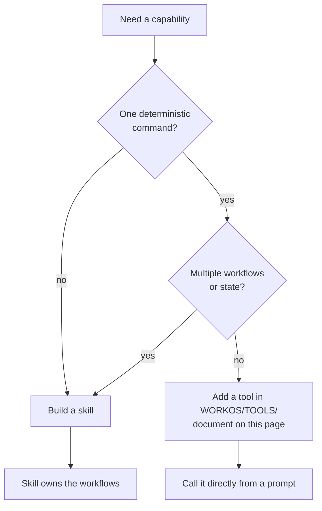

# WorkOS Tools - CLI Utilities Reference

> CLI-first is how the OS stays deterministic (`WORKOS/DOCUMENTATION/WorkOs/WorkOsThesis.md`): the hill-climb's moves are code you can script, test, and trust — prompts orchestrate, code executes.

This file documents single-purpose CLI utilities that have been consolidated from individual skills. These are pure command-line tools that wrap APIs or external commands.

**Philosophy:** Simple utilities don't need separate skills. Document them here, execute them directly.

**Model:** Following the `Tools/fabric/` pattern - 242+ Fabric patterns documented as utilities rather than individual skills.

---

## Inference.ts - Unified AI Inference Tool

**Location:** `~/.claude/WORKOS/TOOLS/Inference.ts`

**Use this — never import `@anthropic-ai/sdk` directly.** Inference.ts handles auth, retries, timeouts, and WorkOS-specific defaults. Hooks, skills, agents, and ad-hoc Bash all route through it.

Single inference tool with four run levels for different speed/capability trade-offs — the same four-level abstraction as `EFFORT_MODEL` in `models.ts` (max→fable, high→opus, medium→sonnet, low→haiku; one-line mapping edit on a lineup change).

**Executed-model verification (v6.29.0).** `--level max` genuinely runs Fable (spawns `claude --model claude-fable-5`), unlike an `Agent(model:fable)` dispatch which downgrades to Opus — so this is the real Fable carrier for max-level reasoning. Every run reads the executed model back from the JSON envelope's `modelUsage` (`verifyExecutedModel` — filters Claude Code's per-turn background haiku pass, then takes the highest-output model as the answer's author and checks its family; presence alone can't tell a tiny classifier pass from real authorship). The result carries `executedModel` + `modelDowngraded`; the CLI prints a `[model] requested=… → executed=…` line to stderr (stdout stays the clean answer); any downgrade is logged to `MEMORY/OBSERVABILITY/model-verification.jsonl`. The tool reports what RAN, never what it requested.

**Usage:**
```bash
# Low (Haiku) - quick tasks, simple generation
bun ~/.claude/WORKOS/TOOLS/Inference.ts --level low "System prompt" "User prompt"

# Medium (Sonnet) - balanced reasoning, typical analysis
bun ~/.claude/WORKOS/TOOLS/Inference.ts --level medium "System prompt" "User prompt"

# High (Opus) - deep reasoning, strategic decisions
bun ~/.claude/WORKOS/TOOLS/Inference.ts --level high "System prompt" "User prompt"

# Max (Fable) - hardest reasoning, top tier
bun ~/.claude/WORKOS/TOOLS/Inference.ts --level max "System prompt" "User prompt"

# With JSON output
bun ~/.claude/WORKOS/TOOLS/Inference.ts --json --level low "Return JSON" "Input"

# Custom timeout
bun ~/.claude/WORKOS/TOOLS/Inference.ts --level medium --timeout 60000 "Prompt" "Input"
```

**Run Levels:**
| Level | Model | Default Timeout | Use Case |
|-------|-------|-----------------|----------|
| **low** | Haiku | 15s | Quick tasks, simple generation, basic classification |
| **medium** | Sonnet | 30s | Balanced reasoning, typical analysis, decisions |
| **high** | Opus | 90s | Deep reasoning, strategic decisions, complex analysis |
| **max** | Fable | 120s | Keystone decisions, hardest reasoning (the TheRouter classifier that formerly used this level was retired 2026-07-11) |

**Programmatic Usage:**
```typescript
// From hooks (at ~/.claude/hooks/):
import { inference } from '../../.claude/WORKOS/TOOLS/Inference';

const result = await inference({
  systemPrompt: 'Analyze this',
  userPrompt: 'Content to analyze',
  level: 'medium',  // 'low' | 'medium' | 'high' | 'max'
  expectJson: true,   // optional: parse JSON response
  timeout: 30000,     // optional: custom timeout
});

if (result.success) {
  console.log(result.output);
  console.log(result.parsed);  // if expectJson: true
}
```

**When to Use:**
- "quick inference" → low
- "analyze this" → medium
- "deep analysis" → high
- keystone decisions (classifier) → max
- Hooks use this for sentiment analysis, tab titles, work classification

**Technical Details:**
- Spawns the Claude CLI and inherits the harness auth (Bedrock in the sandbox, subscription elsewhere); never an injected API key
- Disables tools and hooks to prevent recursion
- Returns latency metrics for monitoring

---

## RemoveBg.ts - Remove Image Backgrounds

**Location:** `~/.claude/WORKOS/TOOLS/RemoveBg.ts`

Remove backgrounds from images using local `rembg` (no external API).

**Usage:**
```bash
# Remove background from single image (overwrites; renames .jpg→.png)
bun ~/.claude/WORKOS/TOOLS/RemoveBg.ts /path/to/image.png

# Remove background and save to different path
bun ~/.claude/WORKOS/TOOLS/RemoveBg.ts /path/to/input.png /path/to/output.png

# Process multiple images
bun ~/.claude/WORKOS/TOOLS/RemoveBg.ts image1.png image2.png image3.png
```

**Requirements:**
- `rembg` installed at `~/.local/bin/rembg` (override with `REMBG_BIN` env var)
- Install: `pipx install rembg` (or `uv tool install rembg`)

**When to Use:**
- "remove background from this image"
- "remove the background"
- "make this image transparent"

---

## AddBg.ts - Add Background Color

**Location:** `~/.claude/WORKOS/TOOLS/AddBg.ts`

Add solid background color to transparent images.

**Usage:**
```bash
# Add specific background color
bun ~/.claude/WORKOS/TOOLS/AddBg.ts /path/to/transparent.png "#EAE9DF" /path/to/output.png

# Add your brand background color (uses the color from WorkOS config)
bun ~/.claude/WORKOS/TOOLS/AddBg.ts /path/to/transparent.png --brand /path/to/output.png
```

**When to Use:**
- "add background to this image"
- "create thumbnail with UL background"
- "add the brand color background"

**Example brand color:** `#EAE9DF` (warm paper/sepia tone — configure your own via WorkOS config)

---

## GetTranscript.ts - Extract YouTube Transcripts

**Location:** `~/.claude/WORKOS/TOOLS/GetTranscript.ts`

Extract transcripts from YouTube videos using yt-dlp (via fabric).

**Usage:**
```bash
# Extract transcript to stdout
bun ~/.claude/WORKOS/TOOLS/GetTranscript.ts "https://www.youtube.com/watch?v=VIDEO_ID"

# Save transcript to file
bun ~/.claude/WORKOS/TOOLS/GetTranscript.ts "https://www.youtube.com/watch?v=VIDEO_ID" --save /path/to/transcript.txt
```

**Supported URL Formats:**
- `https://www.youtube.com/watch?v=VIDEO_ID`
- `https://youtu.be/VIDEO_ID`
- `https://www.youtube.com/watch?v=VIDEO_ID&t=123` (with timestamp)
- `https://youtube.com/shorts/VIDEO_ID` (YouTube Shorts)

**When to Use:**
- "get the transcript from this YouTube video"
- "extract transcript from this video"
- "fabric -y <url>" (user explicitly mentions fabric)

**Technical Details:**
- Uses `fabric -y` under the hood
- Prioritizes manual captions when available
- Falls back to auto-generated captions
- Multi-language support (detects automatically)

---

## MemoryRetriever.ts - Compressed Knowledge Retrieval

**Location:** `~/.claude/WORKOS/TOOLS/MemoryRetriever.ts`

BM25-lite search across the Knowledge Archive with optional LLM compression. Finds relevant notes by keyword matching, tag co-occurrence, and content frequency, then compresses results into a dense context-efficient summary.

**Usage:**
```bash
# Search and return compressed results (default: top 3)
bun ~/.claude/WORKOS/TOOLS/MemoryRetriever.ts "memory architecture"

# Return top 5 results
bun ~/.claude/WORKOS/TOOLS/MemoryRetriever.ts "security policy" --top 5

# Skip LLM compression, return raw excerpts
bun ~/.claude/WORKOS/TOOLS/MemoryRetriever.ts "karpathy" --raw

# Custom token budget for output
bun ~/.claude/WORKOS/TOOLS/MemoryRetriever.ts "threat model" --budget 800
```

**Scoring:**
| Signal | Weight | Source |
|--------|--------|--------|
| Title match | +10 | Frontmatter title |
| Tag match | +5 | Frontmatter tags |
| Related slug match | +3 | Frontmatter related field |
| Content frequency | BM25 | Full body text |

**When to Use:**
- "what do we know about X" → search knowledge
- "find related notes about Y" → search + follow links
- Context loading during Algorithm THINK phase knowledge checks
- Retrieving compressed context for constrained token budgets

---

## KnowledgeGraph.ts - Associative Knowledge Navigation

**Location:** `~/.claude/WORKOS/TOOLS/KnowledgeGraph.ts`

Builds an in-memory graph from Knowledge Archive frontmatter (tags, wikilinks, related fields) and enables BFS traversal for associative recall. No persistent storage — computed from existing markdown files at query time.

**Usage:**
```bash
# BFS traversal from a note (default: 2 hops)
bun ~/.claude/WORKOS/TOOLS/KnowledgeGraph.ts traverse karpathy

# Traverse with custom depth
bun ~/.claude/WORKOS/TOOLS/KnowledgeGraph.ts traverse mempalace --hops 3

# Show directly connected notes
bun ~/.claude/WORKOS/TOOLS/KnowledgeGraph.ts related mempalace

# Graph summary: nodes, edges, clusters
bun ~/.claude/WORKOS/TOOLS/KnowledgeGraph.ts stats

# Top 10 most-connected notes
bun ~/.claude/WORKOS/TOOLS/KnowledgeGraph.ts hubs

# Find all notes with a specific tag
bun ~/.claude/WORKOS/TOOLS/KnowledgeGraph.ts find architecture
```

**Edge Types:**
| Type | Weight | Source |
|------|--------|--------|
| Tag co-occurrence | 1 | Shared tags in frontmatter |
| Wikilink | 3 | `[[slug]]` in body text |
| Related field | 5 | Typed `related:` in frontmatter |

**When to Use:**
- "what's connected to this topic" → traverse
- "show me the knowledge graph" → stats + hubs
- "find related notes" → related <slug>
- Exploring how knowledge connects across domains

---

## extract-transcript.py - Transcribe Audio/Video Files

**Location:** `~/.claude/WORKOS/TOOLS/extract-transcript.py`

Local transcription using faster-whisper (4x faster than OpenAI Whisper, 50% less memory). Self-contained UV script for offline transcription.

**Usage:**
```bash
# Transcribe single file (base.en model - recommended)
cd ~/.claude/WORKOS/TOOLS/
uv run extract-transcript.py /path/to/audio.m4a

# Use different model
uv run extract-transcript.py audio.m4a --model small.en

# Generate subtitles
uv run extract-transcript.py video.mp4 --format srt

# Batch transcribe folder
uv run extract-transcript.py /path/to/folder/ --batch --model base.en
```

**Supported Formats:**
- **Audio:** m4a, mp3, wav, flac, ogg, aac, wma
- **Video:** mp4, mov, avi, mkv, webm, flv

**Output Formats:**
- **txt** - Plain text transcript (default)
- **json** - Structured JSON with timestamps
- **srt** - SubRip subtitle format
- **vtt** - WebVTT subtitle format

**Model Options:**
| Model | Size | Speed | Accuracy | Use Case |
|-------|------|-------|----------|----------|
| tiny.en | 75MB | Fastest | Basic | Quick drafts, testing |
| **base.en** | 150MB | Fast | Good | **General use (recommended)** |
| small.en | 500MB | Medium | Very Good | Important recordings |
| medium | 1.5GB | Slow | Excellent | Production quality |
| large-v3 | 3GB | Slowest | Best | Critical accuracy needs |

**When to Use:**
- "transcribe this audio"
- "transcribe recording"
- "extract transcript from audio"
- "convert audio to text"
- "generate subtitles"

**Technical Details:**
- 100% local processing (no API calls, completely offline)
- First run auto-installs dependencies via UV (~30 seconds)
- Models auto-download from HuggingFace on first use
- Apple Silicon (M1/M2/M3) optimized
- Processing speed: ~3-5 minutes for 36MB audio file (base.en model)

**Prerequisites:**
- UV package manager: `curl -LsSf https://astral.sh/uv/install.sh | sh`
- No manual model download required (auto-downloads on first use)

---

## TruffleHog - Scan for Exposed Secrets

**Location:** System-installed CLI tool (`brew install trufflehog`)

Scan directories for 700+ types of credentials and secrets.

**Usage:**
```bash
# Scan directory
trufflehog filesystem /path/to/directory

# Scan git repository
trufflehog git file:///path/to/repo

# Scan with verified findings only
trufflehog filesystem /path/to/directory --only-verified
```

**Installation:**
```bash
brew install trufflehog
```

**When to Use:**
- "check for secrets"
- "scan for sensitive data"
- "find API keys"
- "detect credentials"
- "security audit before commit"

**What It Detects:**
- API keys (OpenAI, AWS, GitHub, Stripe, 700+ services)
- OAuth tokens
- Private keys (SSH, PGP, SSL/TLS)
- Database connection strings
- Passwords in code
- Cloud provider credentials

**Technical Details:**
- Scans files, git history, and commits
- Uses entropy detection + regex patterns
- Verifies findings when possible (calls APIs to check if keys are valid)
- No API key required (standalone CLI tool)

---

## RTK — Context Reduction Proxy

**Location:** `~/.local/bin/rtk` (installed via `curl -fsSL https://raw.githubusercontent.com/rtk-ai/rtk/refs/heads/master/install.sh | sh`)

**Repository:** [github.com/rtk-ai/rtk](https://github.com/rtk-ai/rtk) (MIT license)

Transparent CLI proxy that compresses the output of a few high-volume commands before it reaches Claude Code's context. Integrated via a PreToolUse hook that rewrites matching commands to their `rtk` equivalents before execution.

**`rtk` is an OPTIONAL dependency, not bundled by the installer.** Without `rtk` on PATH the hook is an inert passthrough — it never errors and never blocks a command. To enable it, install rtk separately (see Location above). This is deliberate: the installer ships no third-party binary.

**Scope (2026-07-13 shrink):** the hook rewrites **only** `git` (status/diff/log/commit/push/pull/branch/fetch/stash/show), `gh` (pr/issue/run/api/release), and an `interceptor screenshot --save` output redirect. An earlier build carried a ~15-family rewrite table (cargo, vitest, pytest, go, docker, kubectl, npm, pnpm, tsc, eslint, prettier, prisma, ruff, mypy); those were removed because they are not this system's stack (bun/TS) and the table was dead weight.

**What it does NOT touch (INVARIANT):** read-path commands whose stdout the model reasons over as evidence — `rg`/`grep`, `cat`/`head`, `ls`/`tree`/`find`, `diff`, `curl`/`wget`, `psql`/`aws`. rtk's parse-fail there falls back to a different binary (`rg`→BSD grep) and can silently corrupt results. Compress what the model *watches* (VCS status, gh metadata), never what it *reads*. Incident: 2026-06-10 Vector ISA miss.

**Measured value (this install):** `git status` ≈69% smaller, `gh pr diff` ≈65%, `git log` ≈42%. `rtk gain` reports a much larger lifetime figure, but most of that is direct/manual rtk usage of read-path commands (curl, grep, ls) that the hook does **not** rewrite — the hook's own contribution is the git/gh subset.

**Key Commands:**
```bash
rtk gain              # rtk's own token-savings ledger (all rtk usage, not just the hook)
rtk --help            # supported subcommands
```

**Technical Details:**
- Rust binary, zero runtime dependencies
- 3-tier parsing: JSON → regex → passthrough (graceful degradation)
- SQLite tracking database at `~/.config/rtk/history.db`
- Hook requires `jq` (for JSON stdin parsing) in addition to `rtk`
- Regression gate: `cd ~/.claude/hooks && bun test ContextReduction.test.ts`

---

## Monitor Tool — Event-Driven Background Watching

The Monitor tool starts a background script whose stdout lines become chat notifications. Instead of polling in a loop (burning tokens), the script runs independently and wakes you when something happens. Zero token cost between events.

**Key rules:**
- Each stdout line = one notification. Stderr goes to output file only.
- Always use `grep --line-buffered` in pipes (otherwise pipe buffering delays events).
- Poll intervals: 30s+ for remote APIs, 0.5-1s for local checks.
- Handle transient failures: `curl ... || true` in poll loops.
- Set `persistent: true` for session-length watches. Cancel with `TaskStop`.

### Recipe: Agent Watchdog (auto-triggered by hook)

The agent-guard hook automatically injects a watchdog reminder when background agents are spawned. The watchdog monitors tool-activity.jsonl for silence while agents are active:

```bash
Monitor({
  description: "Agent watchdog",
  persistent: true,
  timeout_ms: 3600000,
  command: "bun $HOME/.claude/WORKOS/TOOLS/AgentWatchdog.ts"
})
```

Alerts when no tool calls detected for 90 seconds with active agents. Rate-limited to one alert per 60 seconds. Runs for the session lifetime — covers all background agents.

### Recipe: Build/Test Watching

Monitor a long test suite and get notified on failures:

```bash
Monitor({
  description: "Test failure watcher",
  persistent: false,
  timeout_ms: 600000,
  command: "tail -f /tmp/test-output.log | grep --line-buffered -E '(FAIL|ERROR|✗|AssertionError)'"
})
```

### Recipe: PR/CI Status Monitoring

Poll GitHub for CI status changes on a PR:

```bash
Monitor({
  description: "CI status for PR #42",
  persistent: true,
  timeout_ms: 3600000,
  command: "last_status=''; while true; do status=$(gh pr checks 42 --json state --jq '.[].state' 2>/dev/null | sort -u | tr '\\n' ','); if [ \"$status\" != \"$last_status\" ]; then echo \"CI: $status\"; last_status=\"$status\"; fi; sleep 30; done"
})
```

### Recipe: Security Scan Watching

Tail security scan results for critical findings:

```bash
Monitor({
  description: "Security scan critical findings",
  persistent: false,
  timeout_ms: 600000,
  command: "tail -f /tmp/security-scan.log | grep --line-buffered -i 'CRITICAL'"
})
```

---

## Integration with Other Skills

### Art Skill
- Background removal: `RemoveBg.ts`
- Add backgrounds: `AddBg.ts`

### Research Skill
- YouTube transcripts: `GetTranscript.ts`
- Audio/video transcription: `extract-transcript.py`

### Security Workflows
- Secret scanning: `trufflehog` (system tool)

---

## Adding New Tools

When adding a new utility tool to this system:

1. **Add tool file:** Place `.ts` or `.py` file directly in `~/.claude/WORKOS/TOOLS/`
   - Use **Title Case** for filenames (e.g., `GetTranscript.ts`, not `get-transcript.ts`)
   - Keep the directory flat — a single-file tool goes directly in `TOOLS/`, never in a folder of its own.
     Subdirectories are the named exception, not a free choice: `Conveyor/` (a multi-file subsystem) and
     `lib/` (helpers shared across tools) are sanctioned, and a handful of other multi-file subsystems
     have since followed the same pattern. Adding a new one means documenting it here first.
     <!-- ported from public PR #1707 (commit 1), @anikinsasha — the bare "NO subdirectories"
          rule contradicted the tree it described -->


2. **Document here:** Add section to this file with:
   - Tool location (e.g., `~/.claude/`)
   - Usage examples
   - When to use triggers
   - Environment variables (if any)

3. **Update `CLAUDE.md` routing table:** Ensure TOOLS.md is referenced in the documentation index

4. **Test:** Verify tool works from new location

**Don't create a separate skill** if the entire functionality is just a CLI command with parameters.

---

## Deprecated Skills

The following skills have been consolidated into this Tools system:

- **Images** → `Tools/RemoveBg.ts`, `Tools/AddBg.ts` (2024-12-22)
- **VideoTranscript** → `Tools/GetTranscript.ts` (2024-12-22)
- **ExtractTranscript** → `Tools/extract-transcript.py` (2024-12-22)
- **Sensitive** → `trufflehog` system tool (2024-12-22)

Archived skill files have been removed.

---

## KnowledgeHarvester.ts - Knowledge Archive Harvester

**Location:** `~/.claude/WORKOS/TOOLS/KnowledgeHarvester.ts`

Validate and maintain the KNOWLEDGE/ archive (4 entity types: People, Companies, Ideas, Research). Validates against schemas in `_schema.md`, handles MOC regeneration and maintenance. Note: Algorithm LEARN phase writes knowledge directly; harvester reflections are disabled. The harvester's primary role is now validation, maintenance, and index regeneration.

**Usage:**
```bash
# Harvest from all sources
bun ~/.claude/WORKOS/TOOLS/KnowledgeHarvester.ts harvest

# Harvest from specific source
bun ~/.claude/WORKOS/TOOLS/KnowledgeHarvester.ts harvest --source work

# Preview without writing
bun ~/.claude/WORKOS/TOOLS/KnowledgeHarvester.ts harvest --dry-run

# Archive health dashboard
bun ~/.claude/WORKOS/TOOLS/KnowledgeHarvester.ts status

# Regenerate all MOC dashboards
bun ~/.claude/WORKOS/TOOLS/KnowledgeHarvester.ts index
```

**Sources:**
| Source | Flag | What It Scans |
|--------|------|---------------|
| memory | `--source memory` | Auto-memory files from Claude sessions |
| work | `--source work` | WORK/ directory ISAs and session artifacts |
| reflections | `--source reflections` | Learning/reflection documents |
| research | `--source research` | RESEARCH/ directory content |

**When to Use:**
- "harvest knowledge"
- "update knowledge archive"
- "knowledge status"
- "regenerate knowledge index"

---

## models.ts + UpdateModels.ts — Model ID Registry & Release Auto-Track

**Location:** `~/.claude/WORKOS/TOOLS/models.ts` (registry) + `~/.claude/WORKOS/TOOLS/UpdateModels.ts` (updater).

`models.ts` is the **single source of truth** for current Claude model IDs (`CURRENT.opus/sonnet/haiku`) plus cross-vendor pins (inventory only). The rule of the road:

- **Prefer aliases.** Consumers that accept a string and don't need a pinned ID use the tier alias (`"opus"`/`"sonnet"`/`"haiku"`/`"fable"`) — the `claude` CLI resolves each to the LATEST model in that tier (`claude --help`: "Provide an alias for the latest model"), so they never drift. This is the system's auto-update mechanism; a pinned ID is the staleness source. `Inference.ts` works this way. A tier name IS its alias — the former `ALIAS` record was an identity map and was deleted 2026-07-24.
- **Import the registry** only when you genuinely need a pinned ID (e.g. `ContextAudit.ts`'s drift check imports `currentModel("opus")`).
- **Never** hardcode a dated ID in live code — that's the bug class this replaced (`ContextAudit` checked for `claude-opus-4-7` long after 4.8 shipped).

**On a new model release (propose-not-auto):**
1. The Upgrade skill's Anthropic monitor (`CheckAnthropicChanges.ts`) scans fetched source bodies for a new Claude ID and, on a hit, records it to `WORKOS/MEMORY/OBSERVABILITY/model-releases.jsonl`. It never edits the registry. (A model bump is a command, not a markdown-section text edit, so it deliberately does NOT use the `pending-proposals.jsonl` proposal queue — that queue's apply path only appends text under a header.)
2. A human reviews, then bumps the one edit point: `bun ~/.claude/WORKOS/TOOLS/UpdateModels.ts --apply <tier> <new-id>`.
3. Confirm nothing else drifted: `bun ~/.claude/WORKOS/TOOLS/UpdateModels.ts --check` (also runnable any time as a drift alarm; exit 1 on drift).

Historical Algorithm doctrine snapshots (`WORKOS/ALGORITHM/v*.md`), the Algorithm changelog, co-located `.test.ts` fixtures, skill `/State/` runtime caches, eval configs (which pin a model on purpose for reproducible comparison), and price tables keyed by past IDs are all excluded from the drift scan — see `SCAN_EXCLUDES`. `--check` reports two classes: **stale** (wrong now) and **pinned-but-current** (right today, will rot on the next bump — prefer an alias).

## ArchitectureSummaryGenerator.ts - Architecture Summary Generator

**Location:** `~/.claude/WORKOS/TOOLS/ArchitectureSummaryGenerator.ts`

Generate `ARCHITECTURE_SUMMARY.md` from WorkosSystemArchitecture.md and subsystem docs. Provides a compact architecture overview derived from the master architecture document.

**Usage:**
```bash
# Generate/regenerate the architecture summary
bun ~/.claude/WORKOS/TOOLS/ArchitectureSummaryGenerator.ts generate

# Check if summary is stale (exit 1 if stale, 0 if fresh)
bun ~/.claude/WORKOS/TOOLS/ArchitectureSummaryGenerator.ts check
```

**When to Use:**
- "regenerate architecture summary"
- "check if architecture summary is stale"
- After modifying WorkosSystemArchitecture.md

---

## Doctor.ts - Capability Prober & Health Manifest

**Location:** `~/.claude/WORKOS/TOOLS/Doctor.ts`

Probes the external tools WorkOS doctrine assumes but the core install does not ship — Interceptor (browser verification) — plus core wiring, and writes an **advisory** capability manifest at `MEMORY/STATE/capabilities.json`. Born from onboarding-friction feedback (discussion #1461): capabilities assumed but never verified degrade silently, and change-scoped checks can't see what's dormant at rest.

Five states per capability: `live` / `broken` / `declined` / `stale` / `off`. `off` is an optional capability with no local configuration — the read-only work context (`glab`, `jira`) is off until `GITLAB_HOST`/glab or `JIRA_URL` exist; `--network` adds Jira's `GET /rest/api/3/myself`. The manifest is a **TTL'd cache, never truth** — it carries a salted integrity hash and readers re-verify doctrine-critical capabilities live at point-of-use. `declined` is a first-class permanent, silent opt-out. Diagnostic register only — no scores, no percentages.

**Usage:**
```bash
# Probe (offline checks), human table
bun ~/.claude/WORKOS/TOOLS/Doctor.ts

# Include network probes (only for configured capabilities — no pre-consent egress)
bun ~/.claude/WORKOS/TOOLS/Doctor.ts --network

bun ~/.claude/WORKOS/TOOLS/Doctor.ts --json          # machine-readable
bun ~/.claude/WORKOS/TOOLS/Doctor.ts --verify        # integrity-check the manifest (exit 2 on tamper)
bun ~/.claude/WORKOS/TOOLS/Doctor.ts --reconcile     # hooks declared-on-disk vs registered-in-settings
bun ~/.claude/WORKOS/TOOLS/Doctor.ts --statusline    # one glyph if a NEW regression since ack, else empty
bun ~/.claude/WORKOS/TOOLS/Doctor.ts decline <cap>   # permanent silent opt-out
bun ~/.claude/WORKOS/TOOLS/Doctor.ts enable <cap>    # undo a decline
bun ~/.claude/WORKOS/TOOLS/Doctor.ts ack             # acknowledge the current broken set (statusline delta base)
```

**Consumers (read the manifest, never write it):** the statusline delta line (precomputed sidecar), the `AlgorithmNudge` capability row (fires at the moment a broken capability's command fails — reads only `state`, fix command is a static in-hook constant). Never install-fatal: the default run always exits 0; every probe is timeout-bounded.

**When to Use:**
- "run the doctor", "check capabilities", "why is browser verification not working"
- Post-install (INSTALL.md step 8.5) and any time something feels off

---

## MCP Servers

**Config:** `~/.claude/.mcp.json`

WorkOS connects to external MCP servers for domain-specific tool access.

| Server | Type | Endpoint | Controllable |
|--------|------|----------|-------------|
| *(example)* **your-mcp** | HTTP | `your-mcp.example.com/mcp` | Yes, if you run the server |

### Result Size Override (Claude Code v2.1.91+)

MCP tool results are truncated by default. Servers can override this by adding `_meta["anthropic/maxResultSizeChars"]` to their tool result annotations, allowing results up to **500K characters** without truncation.

**This is a server-side annotation** — the MCP server must add it to its responses. There is no client-side setting.

**Implementation example (in MCP server response):**
```json
{
  "content": [{ "type": "text", "text": "...large result..." }],
  "_meta": {
    "anthropic/maxResultSizeChars": 500000
  }
}
```

**WorkOS applicability:**
- **Servers you run** — can add this annotation for tools that return large analysis payloads.
- **External servers** — the annotation must be added upstream by their maintainers.

---

## Examples

### The whole idea: don't hand-roll what's already one command

You need the transcript of a YouTube talk. The wrong move is to reach for `yt-dlp` flags and stitch together caption parsing by hand every time. The right move is one line:

```bash
bun ~/.claude/WORKOS/TOOLS/GetTranscript.ts "https://www.youtube.com/watch?v=VIDEO_ID"
```

The tool already handles the URL formats, prefers manual captions, falls back to auto-generated, and detects the language. It is documented here rather than wrapped in a skill because it is exactly one deterministic command with parameters — nothing to orchestrate, no state to carry, no judgment to make. The prompt decides *when* to run it; the code does the work the same way every time.

### Tool or skill? One question decides

The line between "document it here" and "build a skill" is sharp:

- **A tool** is a single command that wraps an API or binary and returns a result — background removal, a transcript, a stats pull. It lives flat in `WORKOS/TOOLS/`, gets a section on this page, and is called directly.
- **A skill** is warranted the moment there are multiple workflows, persistent state, or a decision the model has to make about how to proceed. A transcript fetch is a tool; a research pass that fetches, reads, cross-checks, and synthesizes is a skill.

Get this wrong toward the skill side and you have buried a one-liner under ceremony; wrong toward the tool side and you are re-deriving a workflow in the prompt every time.



The default bias is toward the bottom-left branch: most needs are one command, and a documented utility beats a new skill every time the work is genuinely deterministic.

---

## Related Documentation

- **Architecture**: `~/.claude/WORKOS/DOCUMENTATION/WorkosSystemArchitecture.md` (master architecture reference)

---

**Last Updated:** 2026-04-20
