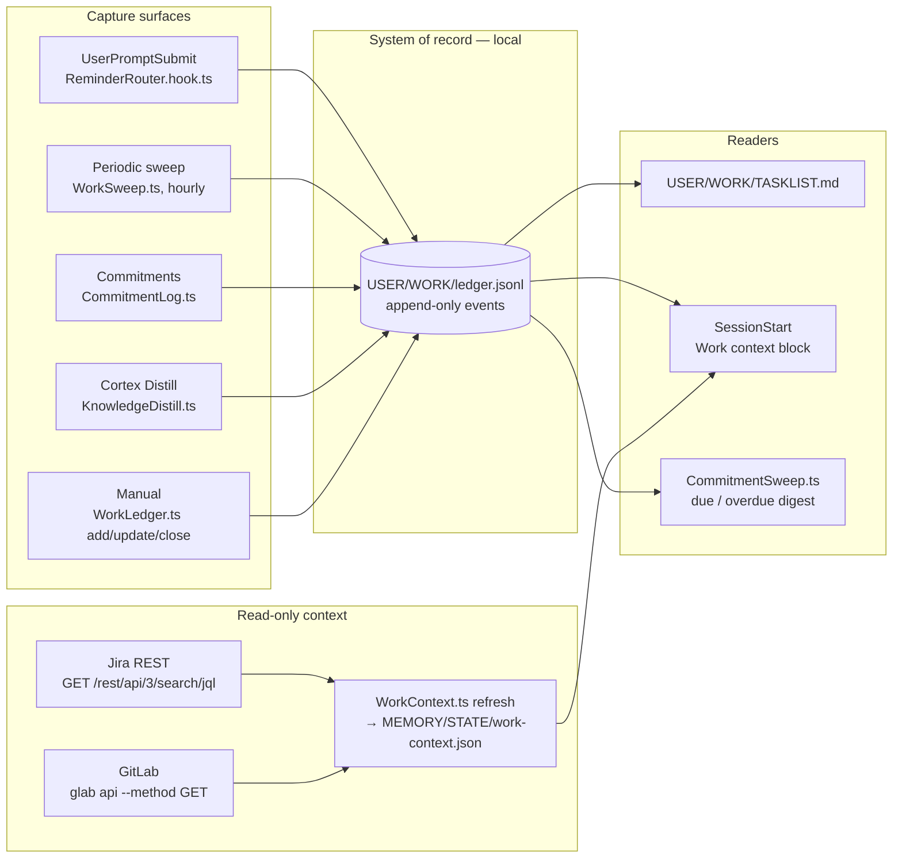

# Work System

> The Work System is the hill-climb's ledger (`WORKOS/DOCUMENTATION/WorkOs/WorkOsThesis.md`). Every captured unit of work is a step taken toward ideal state, and the TELOS sweep is the loop closing on itself: an active goal with no open item is a declared ideal state with no next move — exactly the gap the OS exists to surface.

The Work System turns every meaningful unit of work — Algorithm sessions, NATIVE work that touched files, explicit reminders, check-ins on stale projects, TELOS goals without a next action, commitments with a due date — into an item in a **local ledger** inside the config tree. The ledger is the system of record. `TASKLIST.md` is its rendered view.

**GitLab and Jira are read-only context.** WorkOS reads your sprint tickets and your merge requests so the session knows what you are working on. It never creates, edits, transitions or comments on anything in Jira or GitLab. Ticket updates stay with your team's own process, outside WorkOS.

## Why a local ledger

The previous design kept the system of record in a private GitHub repo and reached it through `gh`. That does not fit the target environment: a Docker Sandbox (Linux microVM) with deny-all egress, where the employer's tools are GitLab and Jira, and where the team's Jira workflow is a compliance surface WorkOS must not touch. A local, append-only file has none of those problems: it works offline, needs no credentials, persists in the sandbox workspace, and its history is the file itself.

## Architecture



There is no arrow from WorkOS into Jira or GitLab. That is the design, and it is enforced in code (see **Never-write rule**).

## The ledger

**Storage:** `WORKOS/USER/WORK/ledger.jsonl`. One JSON event per line — `create`, `update` or `close` — appended with a single `O_APPEND` write, so concurrent writers never interleave inside a line. Current state is the fold of the log in file order. Library: `WORKOS/TOOLS/lib/work-ledger.ts` (pure fold / filter / render, plus the IO layer).

**Item fields:**

| Field | Values |
|-------|--------|
| `id` | `W-<yyMMdd>-<4 hex>` |
| `type` | task, reminder, research, queue, session, project-check, goal, commitment, idea |
| `title`, `body` | text |
| `status` | queued, ready, in-progress, blocked, in-review, done, dropped |
| `priority` | P0–P3 (optional) |
| `labels[]` | free-form, e.g. `auto-sweep`, `kind:research`, `stale` |
| `source` | manual, reminder-router, worksweep, commitment, distill |
| `slug` | idempotency key, unique among non-closed items |
| `links` | `{ jira: string[], mr: string[], isa?, branch?, project? }` — references only |
| `due` | ISO date (optional) |
| `created` / `updated` / `closed` | timestamps from the events |

**Idempotency:** adding an item whose `slug` is held by an open item returns that item instead of creating a second one. Every capture surface sets a slug, so a re-run never duplicates.

**Corruption tolerance:** a read never throws. An unparseable line is skipped and counted (`WorkLedger.ts list --json` reports `corrupt_lines`; WorkSweep logs `ledger_corrupt_lines`). An append after a torn (unterminated) last line starts on a fresh line, so one crash costs one line.

**Rendered view:** `WORKOS/USER/WORK/TASKLIST.md`, one section per status in the configured order, then the 20 most recently closed. The render is deterministic, and the file is rewritten only when the content changes. Do not edit it by hand.

**CLI:** `WORKOS/TOOLS/WorkLedger.ts`

```bash
bun WORKOS/TOOLS/WorkLedger.ts add --title "Wire retry metrics" --type task --priority P1 --jira ABC-123 --due 2026-11-01
bun WORKOS/TOOLS/WorkLedger.ts list [--status in-progress] [--type commitment] [--label stale] [--all] [--json]
bun WORKOS/TOOLS/WorkLedger.ts show <id>
bun WORKOS/TOOLS/WorkLedger.ts update <id> --status in-progress --link-mr <url> --add-label wip
bun WORKOS/TOOLS/WorkLedger.ts close <id> [--note "merged"] [--dropped]
bun WORKOS/TOOLS/WorkLedger.ts find --slug goal:G0
bun WORKOS/TOOLS/WorkLedger.ts render
```

Item commands print JSON. Exit codes: 0 ok, 1 bad input, 2 not found. Every mutation re-renders TASKLIST.md.

## Capture surfaces

### 1. UserPromptSubmit — `hooks/ReminderRouter.hook.ts`

Precision-biased regexes look for `remind me to X`, `research the Y`, `queue this for Z` at a line start and add a `reminder` / `research` / `queue` item; a parsed relative date ("tomorrow", "next Thursday") becomes `due`. Soft hints deliberately don't match. Idempotent twice over: the prompt hash is routed once per session (`MEMORY/STATE/reminder-router-seen.json`), and the slug (kind + normalized subject) keeps one open item across sessions. One local append, no network, exits 0 always.

### 2. Periodic sweep — `WORKOS/TOOLS/WorkSweep.ts`

Runs hourly from `hooks/MaintenanceJobs.hook.ts` (see **Scheduling**). Sub-sweeps:

| Sub-sweep | Trigger | Output |
|-----------|---------|--------|
| **Session catch-up** | ISA modified in the `--since` window (default 24h), meaningful work, no ledger item with slug `session:<isa-slug>` yet; NATIVE sessions only when `capture_native` | `session` item, `kind:<feature/research/...>` label, Jira keys from the ISA's `jira:` field — else from its branch / slug / dir name |
| **Stale flagging** | `in-progress` item not updated in 7d | adds the `stale` label |
| **Project check** | project in `USER/PROJECTS.md` with no commit in 14d | `project-check` item (slug on the project name) |
| **Goal derivation** | active goal in `USER/TELOS/PRINCIPAL_TELOS.md` → `## Active Goals` with no open goal item | `goal` item (slug `goal:<id>`) |
| **BPE cadence** | no BitterPillEngineering audit stamp in 30d | one `reminder` item |

Then it re-renders TASKLIST.md and appends one JSON line to `MEMORY/OBSERVABILITY/worksweep.jsonl`. No LLM, no network. `--dry-run` writes nothing (it prints what it would create and whether TASKLIST.md would change); `--max-create N` (default 50) caps session items per run; `--since Nh` widens the window; `--stamp-bpe` resets the BPE clock.

### 3. Commitments — `CommitmentLog.ts` / `CommitmentSweep.ts` / `CommitmentDetect.ts`

`CommitmentLog.ts --beneficiary <who> --subject <what> --due YYYY-MM-DD` adds a `commitment` item (title `<who>: <what>`, slug on who + what + due, so a repeat returns the open item). `CommitmentSweep.ts` buckets open commitments by `due` into overdue / due today / due this week / future, prints a digest line when something is overdue or due today, and appends to `MEMORY/OBSERVABILITY/commitment-digest.jsonl`. `CommitmentDetect.ts` is unchanged: it only detects a commitment in a message and returns JSON; logging it is a separate, explicit step.

### 4. Cortex Distill — `KnowledgeDistill.ts`

The weekly distill's content lane files each content candidate as an `idea` item (label `content-idea`, slug from the title hash). The repo/label settings it used to need are gone.

### 5. Manual — `WorkLedger.ts`

Principal or agent operates the ledger directly. Claiming work is `update <id> --status in-progress`; finishing is `close <id> --note "<evidence>"`.

## Read-only integrations — `WORKOS/TOOLS/WorkContext.ts`

```bash
bun WORKOS/TOOLS/WorkContext.ts refresh               # fetch both sources, write the cache
bun WORKOS/TOOLS/WorkContext.ts show [--json]         # print the cache
bun WORKOS/TOOLS/WorkContext.ts summary               # ≤12 plain-text lines
bun WORKOS/TOOLS/WorkContext.ts key-from-branch [b]   # Jira key in a branch name
```

Cache: `WORKOS/MEMORY/STATE/work-context.json` — `fetched_at`, per-source `{ok, skipped?, error?}`, and the items.

| Source | Request | Needs |
|--------|---------|-------|
| **Jira** | `GET $JIRA_URL/rest/api/3/search/jql` with the configured JQL (default: `assignee = currentUser() AND sprint in openSprints() AND statusCategory != Done ORDER BY updated DESC`), fields `summary,status,issuetype,priority,parent`, 5s timeout | `JIRA_URL` (the api.atlassian.com gateway base; `/rest/api/3/...` is appended), `JIRA_USERNAME`, `JIRA_API_TOKEN` (basic auth; in Docker Sandboxes the proxy swaps the placeholders) |
| **GitLab** | `glab api --method GET user`, then MRs I authored (`scope=created_by_me&state=opened`) and MRs where I am reviewer (`reviewer_username=<me>`), with GitLab's `detailed_merge_status` (approval / pipeline state) | `glab` on PATH, authenticated; `GITLAB_HOST` (full URL) names the instance |

A source that is not configured is **skipped**, not failed. A failing source records its error and the other still lands.

### Session context

`hooks/LoadContext.hook.ts` calls `hooks/lib/work-context-block.ts` at SessionStart and injects a short **Work context** block: the current branch and its Jira key (read from `.git/HEAD`, no git spawn), my sprint tickets, my MRs and review requests (from the cache), and ledger items that are in progress, overdue or due within 7 days. When the cache is older than `context_ttl_minutes` it spawns `WorkContext.ts refresh` detached (debounced to one per 2 minutes) and moves on, so the fresh data lands for the next session. No network call ever happens on the SessionStart path; with no integrations configured the block costs well under a millisecond. Skipped for subagents and non-interactive channels, like the rest of the dynamic context; `dynamicContext.workContext: false` in settings turns it off.

### Never-write rule

WorkOS must never create, edit, transition or comment on anything in Jira or GitLab. This is enforced structurally in `WORKOS/TOOLS/lib/work-context.ts`:

- every Jira request goes through `readOnlyFetch()`, which rejects any method but GET, and any request body, **before** the underlying fetch is called;
- every GitLab request is built by `glabGetArgs()`, which only ever produces `glab api --method GET <path>` and refuses a path that carries flags.

`work-context.test.ts` proves both with mocked fetch and spawn, including that a full refresh issues only GET requests. Other glab users are read-only too: the Atlas `gitlab` collector (`GET projects?membership=true`) and `PublicPushGate` (`GET projects/<path>` for visibility). Doctor's `--network` Jira probe is `GET /rest/api/3/myself`.

## Jira keys

Keys differ per team, so nothing hardcodes a project key, an employer, a host or a team. One module owns the rule: `WORKOS/TOOLS/lib/jira-keys.ts`.

- **Pattern:** `[A-Z][A-Z0-9]{1,9}-\d+`, bounded like `\b…\b` except that `_` also counts as a separator (so `ABC-12_fix` matches).
- **Filter:** `jira.project_keys` in config. Non-empty → only those prefixes.
- **Empty filter:** every match except a short list of known false positives — `UTF SHA ISO RFC TLS HTTP SSL ES AES RSA CVE GPT` and `P0`–`P9`-shaped prefixes.
- **`ISC` is always excluded**, filter or not: `ISC-12` is this system's own criteria ID format.
- Branch names: `dev-ABC-123-foo` → `ABC-123`, `fix-ABC-9-x` → `ABC-9`.

## Scheduling

Docker Sandboxes guarantee no systemd, so the recurring jobs run from `hooks/MaintenanceJobs.hook.ts` at SessionStart: each job has its own interval and its own stamp in `MEMORY/STATE/maintenance-jobs.json`, one lock covers them all, and the worker runs detached so session start never waits.

| Job | Interval | Command |
|-----|----------|---------|
| memory-consolidation | 20h | `SessionHarvester.ts --recent 20 && LearningPatternSynthesis.ts --week` |
| proposal-gc | 20h | `ProposalGC.ts --auto` |
| worksweep | 1h | `WorkSweep.ts` |
| commitment-sweep | 20h | `CommitmentSweep.ts` |

A job runs only when a session starts after its interval has elapsed. The systemd timers (`InstallWorkSweep.ts`, `InstallCommitmentSweep.ts`, via `Services.ts`) remain as optional extras for a Linux host with a user systemd session; running both is harmless because every ledger write is slug-idempotent.

## Configuration — `USER/WORK/config.yaml`

Optional; a missing file means defaults: ledger enabled, integrations auto-detected from env. Loader: `hooks/lib/work-config.ts` (zero deps, never throws).

| Key | Default | Purpose |
|-----|---------|---------|
| `enabled` | true | Ledger capture on/off (manual CLI works either way) |
| `kanban_statuses` | in-progress, blocked, in-review, ready, queued | TASKLIST section order |
| `capture_native` | true | Sweep catches NATIVE sessions with artifacts |
| `capture_sweep` | true | Sweep runs at all |
| `capture_reminders` | true | ReminderRouter captures |
| `project_property` | — | ISA `project:` value → project name on items |
| `jira.enabled` | auto (on when `JIRA_URL` set) | Read Jira |
| `jira.project_keys` | [] | Key prefix filter |
| `jira.jql` | open-sprint default | Ticket query |
| `gitlab.enabled` | auto (on when `GITLAB_HOST` set) | Read GitLab |
| `context_ttl_minutes` | 15 | Cache age before a background refresh |

Doctor (`WORKOS/TOOLS/Doctor.ts`) reports `glab` and `jira` as optional capabilities: **off** when unconfigured, live or broken when configured; `--network` adds the Jira `GET /rest/api/3/myself` check.

## Failure modes

| Mode | Behavior | Recovery |
|------|----------|----------|
| Jira / GitLab unreachable or unauthenticated | `refresh` records the source's error in the cache and exits 0; the session block notes it; the ledger is unaffected | Fix env / `glab auth`, then `WorkContext.ts refresh` |
| `glab` absent | GitLab source skipped; Atlas `gitlab` collector reports PARTIAL; Doctor shows off or broken | Install glab, or leave it off |
| Corrupt ledger line | Skipped and counted; everything else folds | Inspect with `list --json`; the line can be removed by hand |
| Crash mid-append | One torn line; the next append starts fresh | none needed |
| Concurrent capture on one slug | mkdir lock around check-then-append; on a stuck lock (>1s) the write proceeds | a rare duplicate can be closed with `--dropped` |
| Sweep crash | MaintenanceJobs retries on the next interval; error in `worksweep.jsonl` / `maintenance-jobs.log` | read the logs |
| First-run flood | `--max-create 50` caps session items | re-run with `--since 720h` to catch up in batches |

## Files

| File | Role |
|------|------|
| `USER/WORK/config.yaml` | Settings (shipped with commented defaults) |
| `USER/WORK/ledger.jsonl` | The ledger — system of record |
| `USER/WORK/TASKLIST.md` | Rendered view |
| `WORKOS/TOOLS/lib/work-ledger.ts` | Ledger library (fold, filter, render, IO) |
| `WORKOS/TOOLS/WorkLedger.ts` | Ledger CLI |
| `WORKOS/TOOLS/lib/jira-keys.ts` | Jira key pattern, filter and false-positive list |
| `WORKOS/TOOLS/lib/work-context.ts` | Read-only Jira/GitLab fetch, guards, cache, summary |
| `WORKOS/TOOLS/WorkContext.ts` | Context CLI (refresh / show / summary / key-from-branch) |
| `hooks/lib/work-config.ts` | Config loader |
| `hooks/lib/work-context-block.ts` | SessionStart block for LoadContext |
| `hooks/ReminderRouter.hook.ts` | Prompt capture |
| `hooks/MaintenanceJobs.hook.ts` | Scheduler (per-job intervals) |
| `WORKOS/TOOLS/WorkSweep.ts` | Periodic sweep |
| `WORKOS/TOOLS/CommitmentLog.ts` / `CommitmentSweep.ts` / `CommitmentDetect.ts` | Commitments |
| `MEMORY/STATE/work-context.json` | Read-only context cache |
| `MEMORY/OBSERVABILITY/worksweep.jsonl`, `commitment-digest.jsonl` | One line per run |

## Example: one reminder's whole journey

Mid-session, someone types **"remind me to renew the TLS cert next week."** `ReminderRouter.hook.ts` matches the `remind me to X` shape and appends one `reminder` item to the ledger with a due date, then re-renders TASKLIST.md. Typing the same sentence tomorrow finds the open item by its slug and adds nothing. When the due date passes, the next session's Work context block lists it as overdue. Nothing was sent anywhere.

---

## Cross-references

- ISA spec: `WORKOS/DOCUMENTATION/ISA/ISAFormat.md`
- Background services: `WORKOS/DOCUMENTATION/Services/BackgroundServices.md`
- System/user boundary doctrine: `WORKOS/DOCUMENTATION/SystemUserBoundary.md`
- Containment policy: `WORKOS/DOCUMENTATION/Tools/Containment.md`
