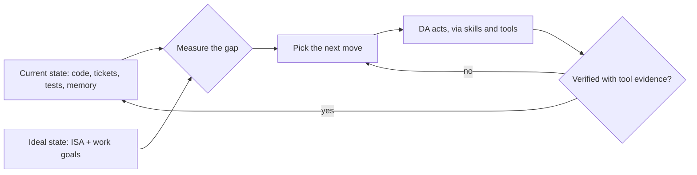

# WorkOS — The Work Operating System Thesis

**The canonical thesis for this system — a work operating system.** Every system doc references this file as the source of truth. If framing elsewhere disagrees with this file, this file wins.

This is a private, work-only fork of the public WorkOS project. The machinery (Algorithm, ISA, memory, skills, hooks, verification) is the same; the scope is the principal's work — the role, the team, the codebases, the tickets.

---

## TL;DR

**WorkOS is the AI harness that moves your work from its current state to its ideal state.** The number one problem with AI systems today is not that they are bad at executing — it is that they do not get clear direction on what to execute. WorkOS is an **intent engineering platform**: it captures what you are trying to achieve at work — your goals, your projects, your definition of done — and conveys that intent to your AI on every task, then verifies the output against it.

Intent engineering extends prompting rather than replacing it. Prompting conveys intent in the moment; intent engineering is the infrastructure that makes every prompt carry what you actually want — not HOW a thing should be done, but WHAT should be done.

- **WorkOS** = the work operating system — the AI harness and intent engineering platform
- **The DA** = your Digital Assistant = the primary interface to the system
- **The AI engine** = the coding agent underneath (Claude Code); "AI harness" is reserved for WorkOS itself

---

## The Intent Problem

Models are extraordinary at executing; what they are starved for is direction. Give a frontier model a vague ask and you get confident motion in a random direction. WorkOS supplies the direction in four layers:

- **TELOS** holds durable intent — professional mission, sprint/quarter/career goals, problems, strategies. The why behind every what.

- **ISAs** hold task intent — what done looks like, written as testable claims (ISC) before the work starts.

- **Memory and context** carry situational intent — your role, your codebases, what you have already decided.

- **Verification** closes the loop — output checked against the stated intent with tool evidence, never against vibes.

The common stack is intent → context → prompt. Context engineering is well covered by the ecosystem; WorkOS operates the tier above it.

---

## The Core Loop — Current State → Ideal State

Every task is the same job: **understand the current state, understand the ideal state, and hill-climb from one to the other.**

- **Current state** comes from the code, the tickets, the test results, memory, and recent sessions.
- **Ideal state** comes from the ISA for the task, framed by TELOS — your work goals.
- **The hill-climb** is what the DA does on every interaction: pick the next move that reduces the gap, then verify it landed.

Memory compounds so the DA understands current state better over time. Skills expand what actions it can take. Hooks enforce rules deterministically. The Algorithm is the systematic version of this loop for every non-trivial task.

### The meta-ideal-state — euphoric surprise

Each task carries its own ideal state, written down in its ISA as testable criteria. Above every one sits the same quality target: **euphoric surprise** — the right output, in the right time, for the right spend, good enough that the principal did not have to ask twice. Each ISA's `## Vision` names what that looks like for that piece of work.

---

## Example — one gap closed

- **Current state:** a payment-settlement job intermittently double-posts when a retry overlaps a slow database commit; there is a ticket, a stack trace, and no reproduction.
- **Ideal state (ISA):** the job is idempotent under concurrent retries; a test reproduces the overlap and passes; no duplicate rows appear in a SELECT over the test run.
- **The hill-climb:** reproduce first (a failing test), then fix, then prove it with the same test plus the SELECT — not "should work".

A stateless chatbot asked "how do I fix duplicate posts" gives everyone the same list. The OS answers for *this* codebase, because it holds the current state and the ideal state and only ever picks the next step between them.

---

## How to describe the system

- **Do say** "WorkOS is the AI harness that moves your work from current state to ideal state" and "an intent engineering platform" — intent engineering is prompting's WHAT layer, productized.
- **Don't say** "prompt engineering is dead" or "WorkOS is scaffolding for AI".
- **Don't hardcode a DA name** in shared content; say "your DA" or "the DA".

---

## Cross-References

| Related system doc | What it covers |
|--------------------|----------------|
| `WORKOS/DOCUMENTATION/WorkosSystemArchitecture.md` | Master architecture — subsystems, pipelines, instruction hierarchy |
| `WORKOS/WORKOS_SYSTEM_PROMPT.md` | Constitutional rules — what the DA must always do |
| `WORKOS/DOCUMENTATION/Algorithm/AlgorithmSystem.md` | The Algorithm — the loop applied to every task |
| `WORKOS/USER/TELOS/` | Work goals, mission, strategies — the ideal-state input |

---

*Canonical work thesis. Source-of-truth document. 2026-10-21.*
