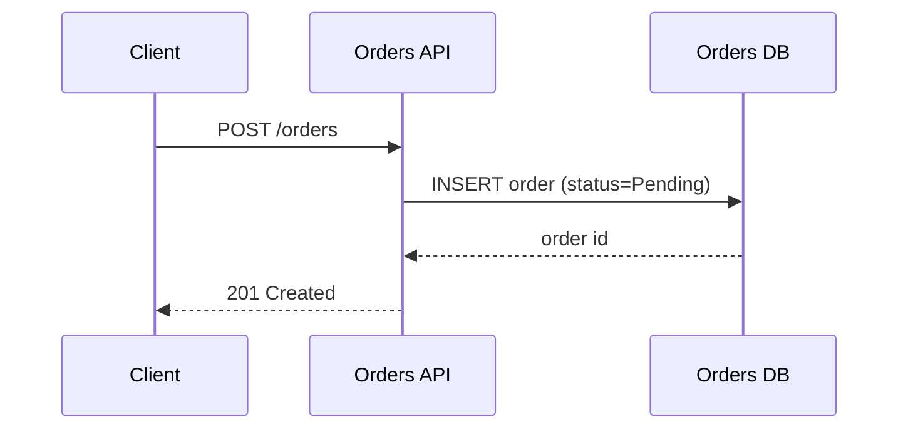

# Mermaid Diagrams

**Structured technical diagrams written as Mermaid source — renders natively in GitLab, GitHub and most Markdown viewers. No image model, no external API.**

## Notification

Running **Mermaid** in **Art**...

---

## Purpose

Turn a process, interaction, lifecycle, data model or plan into a Mermaid diagram that lives next to the code or in a merge request, design doc or ticket. The output is text: reviewable in a diff, editable by anyone, and rendered by the viewer.

---

## Mermaid Diagram Types Supported

### 1. Flowcharts
**When:** Decision trees, algorithmic logic, process flows with conditions
```
Start → Decision? → [Yes] → Action → End
                 → [No] → Different Action → End
```

### 2. Sequence Diagrams
**When:** Interactions between entities/actors over time
```
User → API: Request
API → Database: Query
Database → API: Results
API → User: Response
```

### 3. State Diagrams
**When:** State machines, status transitions, lifecycle flows
```
[Idle] → (trigger) → [Processing] → (complete) → [Done]
                                  → (error) → [Failed]
```

### 4. Class Diagrams
**When:** Object relationships, inheritance, composition
```
User ──has many──> Posts
User ──belongs to──> Organization
Post ──has many──> Comments
```

### 5. Entity Relationship Diagrams
**When:** Database schemas, data models, table relationships
```
Customer ||──o{ Order : places
Order ||──o{ LineItem : contains
Product ||──o{ LineItem : ordered_in
```

### 6. Gantt Charts
**When:** Project timelines, task dependencies, schedules
```
Task 1: Jan 1 - Jan 15
Task 2: Jan 10 - Jan 30 (depends on Task 1)
Task 3: Jan 20 - Feb 10
```

### 7. Git Graphs
**When:** Branching strategies, merge flows, version control
```
main ──> feature branch ──> merged back ──> main
     └──> hotfix ──────────> merged ──────> main
```

---

## Workflow Steps

### Step 1: Understand the content

Read the source (code, ticket, design doc, conversation) and write down in one or two sentences what the diagram must make obvious. If you cannot say it, the diagram will not show it.

### Step 2: Choose the diagram type

#### Decision Framework

**Choose FLOWCHART when:**
- Content describes process with decision points
- "If/then/else" logic is present
- Multiple paths based on conditions
- Algorithm or procedure being explained
- Clear start and end points

**Choose SEQUENCE DIAGRAM when:**
- Content describes interactions between entities over time
- Request/response patterns present
- Multiple actors communicating
- Temporal ordering is critical
- API calls, messaging, or protocols

**Choose STATE DIAGRAM when:**
- Content describes states and transitions
- Status changes are central
- Lifecycle or workflow states
- Event-driven transitions
- System can be in discrete states

**Choose CLASS/ER DIAGRAM when:**
- Content describes relationships between objects/entities
- Data structures or models
- Inheritance or composition patterns
- Database schemas
- Object hierarchies

**Choose GANTT CHART when:**
- Content describes project timeline
- Task dependencies and schedules
- Milestones and deadlines
- Parallel and sequential tasks

**Choose GIT GRAPH when:**
- Content describes version control workflow
- Branching strategies
- Merge patterns
- Release flows

**Multiple diagram types possible?**
- Choose the PRIMARY type that captures the main structure
- Can note that alternative representations exist
- Focus on the most illuminating visualization

**Output from Type Selection:**
```
DIAGRAM TYPE: [Flowchart / Sequence / State / Class / ER / Gantt / Git Graph]

RATIONALE: [Why this type best represents the content]

ALTERNATIVE TYPES CONSIDERED: [If any, and why not chosen]
```

---

### Step 3: Write the Mermaid source

- Keep node labels short (2-5 words); put detail in surrounding prose, not in boxes.
- Use real names from the codebase (service, class, table, queue names) so the diagram can be checked against the code.
- One diagram, one idea. Split a diagram that needs more than ~15 nodes.
- Use `subgraph` to group by service or bounded context; use `classDef` sparingly to highlight the one path that matters.



### Step 4: Validate

- [ ] Every node and edge corresponds to something real in the source — nothing invented
- [ ] The one-sentence point from Step 1 is visible at a glance
- [ ] Syntax renders: paste into the target viewer (GitLab/GitHub preview) or run a local Mermaid renderer if one is installed
- [ ] Labels readable, no crossing-edge spaghetti

### Step 5: Deliver

Return the fenced ```` ```mermaid ```` block, ready to paste into the MR, doc or README. If a file is wanted, write it as `<name>.mmd` (or embed it in the target `.md`).
